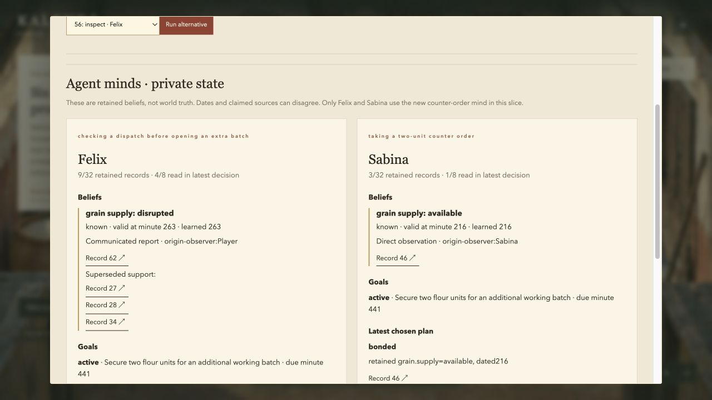

# Kalends Playability + Minds V2 — verified handoff

21 October 2026. Local branch: `codex/playability-minds-v2`. Preserved baseline: `277f645`. This delivers a tested controller and a two-character cognition/economy slice. Human enjoyment, general intelligence and a novel research method have not been established.

**Play:** [existing saved life](http://127.0.0.1:8782/). **Controlled cognition demo:** [private-report case](http://127.0.0.1:8786/) → Continue → menu → World Lab. The demo runs a separate copied journal. Main-save gameplay was not used for QA.

```sh
cd /Users/tanmaygoswami/Claude_backup/Projects/kalends
KALENDS_AI_PROVIDER=offline KALENDS_AI_ALLOW_EXTERNAL=0 ./scripts/start_rebirth.sh --port 8782 --journal .kalends/rebirth_session.json
# Optional fresh life, without replacing the existing save:
KALENDS_AI_PROVIDER=offline KALENDS_AI_ALLOW_EXTERNAL=0 ./scripts/start_rebirth.sh --port 8788 --journal .kalends/minds_v2_fresh_life.json
```

Click the street to walk or a person to approach. Arrows/WASD take short steps; E interacts or stops a walk; Escape cancels uncommitted intent; J opens/closes the journal; M opens the map; X exits a room. Journal → People finds someone at their current place. Review a transaction before confirming it. Live, Wait and skips advance actual obligations. New counter minds activate on the next accepted action in an old save; take a step and let about 16 world minutes pass for buyers that need inspections.

**Exact changes.** [CHANGE_MANIFEST.json](results/minds_v2/CHANGE_MANIFEST.json) enumerates changed paths and every implementation commit relative to the baseline; the final documentation commit is available in Git history. Principal additions are `navigation_v2.py`, `static/navigation.js`, `static/diagnostics.js`, `minds.py`, `cognitive_market.py`, `mindsbench_v2.py`, the isolated renderer probe, game-case runner and focused tests. Existing Rebirth world/session/language/UI files integrate them. The original `kalends/` implementation and prior `results/rebirth/` and `results/pompeii/` studies have no diff. Legacy fixture generators explicitly select legacy semantics; pinned expected hashes were preserved.

Key implementation checkpoints: `fc5c28f` controller/route preview; `a287492` game wiring; `7697e9d` single-context direct/corroborated evidence; `d079a3a` durable reviewed quantities; `a48b85b` public-landmark step fix; `af74d20` focus/gesture cleanup; `04baab1` recipient-scoped drafts; `b13e809` readable Lab and actual goal-completion feedback; `648314d` native play/fork evidence. `e6ac904` attributes a new metric only to inputs from a full stop and their matching accepted movement, and excludes scene-filtered Player draws. Its exact commit is in the manifest. Research is frozen separately at `a8569bf`; recovered evidence is `730889f`, with interpretation boundary `84f0adb`.

**Reproduced defects and measurements.** Full evidence and qualifications are in the [defect register](docs/minds_v2/DEFECT_REGISTER.md), [CPU protocol/raw samples](results/minds_v2/playability/navigation_cpu.json), [baseline browser trace](results/minds_v2/playability/baseline_browser_trace.json) and [continued browser trace](results/minds_v2/playability/continued_browser_trace.json).

| Check | Earlier behavior / evidence | Implemented / observed V2 |
|---|---|---|
| A 26-unit vertical step | 496-unit detour; six world minutes | Direct 26-unit path; one minute in the matched engine case |
| Ten 26-unit horizontal steps vs one 260-unit move | 10 vs 3 world minutes | Both 3; cumulative distance is rounded once |
| Input during a walk | Whole animation blocked retarget/turn | Latest intent replaces uncommitted tail; one short step may already be committed |
| Room travel | Destination label/Lucius prompt appeared while player was visibly on street | Displayed scene controls label/proximity; household → fullery → bakery → food counter exercised |
| Quick tap | RAF sampling could miss a complete down/up; original browser observation was confounded | Keydown queues the tap; deterministic regressions and native browser taps pass |
| Modal/focus changes | Interim V2 harness reproduced resumed walks, rejected held keys and premature labels | Stop, journal, Lab, Wait, blur, response ordering, editable Escape and interrupted pointer state covered |
| Old fountain/forum save | Independent review found an oversized V2 first step | Public aliases normalized; four regressions bound each ordinary step to 48 units |
| Speech draft target | Browser reproduced Felix draft appearing in Sabina conversation | Recipient-scoped drafts and delayed-context protection pass regressions; the recipient-switch fix was not browser-rechecked |

The movement CPU study uses eight matched routes, two revisions and 200 timed calls per cell: **3,200 observations**, with setup/deepcopy outside timing. It includes induced simulation/events, not HTTP/save/rendering. V2 costs slightly more CPU: route medians **0.089–0.269 ms**, versus **0.075–0.137 ms**; V2 p99 is at most **0.768 ms** in these cells. Shorter valid routes are the improvement; a CPU speedup is not claimed.

The earlier continued browser trace at 1280×720/dpr1 records eight accepted inputs, zero ignored inputs and eight next-changed-actor-paint rows. Two rows captured residual prior motion before the new route returned, so these are **not eight causally attributed new-intent trials**. The recorded intervals have lower-empirical p50 **19.6 ms** (conventional median **20.8 ms**), maximum **33.2 ms**. Sixteen HTTP samples have recorded p50 **7.1 ms** (median **7.3 ms**), maximum **16.8 ms**. Its 2,882 retained frame intervals have recorded p50 16.7 ms; Canvas draw p50 0.1 ms/max 0.6 ms. The baseline trace has recorded frame p50 33.3 ms, but **apparatus cadence changed, so no before/after FPS gain is established**. This small warm sample does not establish general latency. An earlier exploratory startup sample was about1.07s and was not retained as a controlled cold-start trace; cold-start tails need further measurement. Heap values exclude server/GPU memory and do not prove long-session stability.

The final [strict-idle trace](results/minds_v2/playability/idle_committed_browser_trace.json) and [protocol/source fingerprints](results/minds_v2/playability/idle_trace_protocol.json) record eight accepted inputs from a full stop, each with its own accepted move response before a changed Player draw, no cancellations and no pending observations. At1280×720/dpr1, median input→committed draw is **31.0ms**, maximum **32.8ms**;16HTTP samples have median **8.8ms**, maximum **16.4ms**. All586 raw rows remain, including529 frame intervals (median16.7ms). The endpoint is **JavaScript Canvas submission**, not browser composition or physical display. This small warm same-room sample does not establish general latency. An earlier strict-idle run (median29.45ms) is separately preserved before the extra scene-filter guard; it is not the final app fingerprint. Nonidle, cancelled, superseded and unmoved inputs are excluded from the causal metric and accounted for separately.

The [actual nine-case Phaser4.2.1 WebGL/Canvas/empty-rAF comparison](results/minds_v2/renderer/INTERPRETATION.md) completed, with all raw intervals preserved. Empty rAF itself changed from about60Hz to30Hz. That invalidates a causal FPS ranking. Canvas had lower submission spans in this tiny fixture; this is neither a GPU benchmark nor evidence about a complete framework migration. Canvas remains in the game. Phaser and its MIT notice are isolated to `/probe/index.html`.

**Working gameplay.** Felix and Sabina fund daily two-unit counter batches from their own cash. A player can buy goods for a six-coin cash sale, post a two-coin bond, or earn a four-coin advance through retained dealings and sufficiently fresh evidence. Partial deliveries move actual goods; completion, forfeiture and advance debt settle from reserved money. A late unit credits advance debt at three coins; repair cannot pay the same reward twice. Buyers pay for inspections, change/withdraw offers and procure for themselves without quest acceptance. Actual batch consumption completes their current goal; the next working window creates a new need.

The browser playthrough completed the opening market arrangement and a two-day continuation: bonded Felix order → typed two-unit purchase → partial delivery with no early payment → completion; Sabina bond → missed deadline/forfeiture; next-day Felix advance → completion; actual replacement goods → Sabina account repaired, without another reward. The saved playthrough checkpoint is minute1518, one coin, no flour, two fulfilled Felix contracts and one repaired Sabina contract. Two later eight-tap diagnostic runs leave the QA life at minute1523/155commands with the same cash, goods and contract outcomes; that journal also restores exactly. The old missed commitment remains historical. Paid work and existing commissions remain available as alternative recovery routes; this walkthrough is not a human fun study.


**Visible cognition and intervention.** In the declared seed80 case, Aelia buys a current inspection and shares it only with Felix. His belief changes to disrupted, he releases six reserved coins and chooses to buy his own verification. Sabina retains her earlier available report and funded bonded offer. Normal conversation exposes authored disclosures; Lab shows private retained episodes, dated beliefs, superseded support, declared goals, last decision/rejected options and evidence links. Removing the actual share action in the browser restores Felix's old belief and six-coin offer while leaving Sabina's belief unchanged. The original history stays intact; the saved fork restores exactly.



[Game diagnostics](results/minds_v2/game_cases_runtime_final.json) and [runner](scripts/minds_v2_game_case.py) also compare hybrid vs recency retention using the same real reviewed initial order, cash, capacity32/context8/consolidation, and 48 matched Felix-only routine admissions. Hybrid offers an advance; recency requires a bond. A fixed disclosed no-wage continuation completes two units versus defaulting with one. This is an authored retention ablation, **not an old-runtime comparison or held-out result**. Experimental policy activation is outside the durable command format, so no save/resume claim is made for those retention arms. The separate correction case uses a versioned accepted-command journal and verifies exact resume. Initial and final diagnostic artifacts are retained with source hashes rather than silently overwritten.

**Implemented mind and planner.** `AgentMind` accepts only supplied per-agent experiences; it has no world/archive handle. Episodic, compact semantic/social, revision and reflection records share one hard cap (runtime32; study12). All action options share one decision context (runtime8; study6). Own goals and latest-decision working state are separately bounded and counted in serialized bytes. Source lineage is communicated, not authenticated; confidence is an uncalibrated heuristic. Rejected testimony does not crowd out accepted facts. Credit signals require accepted direct personal receipt shapes.

The loop is committed event → legitimate observation → bounded encoding/consolidation → dated belief/social revision → declared goal → fixed utility selection → resource/deadline/offer validation → funded execution → consequence/goal feedback. This is a bounded authored action registry, not general planning or a language learner. **Only Felix and Sabina use the new minds**; the other four characters retain existing policies/plans. `AgentMind.reflect` is separately testable, but the study never invokes it and the game has no demonstrated reflection-driven outcome gain or autonomous novel goal creation. The host ledger, institutional accounts and archive remain separate and can grow.

**Research result.** [Registered findings, methods and limitations](results/minds_v2/HELDOUT_FINDINGS.md): 32 fresh paired seeds × six authored families =192 worlds, 14 arms =2,688 executions, common fixed planner, shared information and complete context cap. V2 minus bounded structured utility is **+0.1667**, descriptive paired-seed 95% bootstrap **[0.1042,0.2188]**. All gain is 32 avoided one-coin checks; both complete **176/192**. No consolidation ties V2 in every economic outcome and uses about592 fewer serialized bytes. Eight truthful-rumor controls favor ignoring lineage; eight unobserved false states defeat V2. The other eight noncompletions have deliberately infeasible deadlines. A real dense model was unavailable and no hashed pseudo-vector was presented as competitive embedding retrieval.

The first heldout run's uncommitted output disappeared with a temporary checkout. The preserved exact-method recovery used the same registered source/seeds without tuning; timings/raw hash differ. It is not independent replication. Independent arithmetic/access/budget verification passes all recorded cases. Heldout families/rules and four control variants are authored; fresh parameters/wording do not establish unseen-task or natural-language generalization. Runtime direct-evidence and goal-feedback changes are post-study; effects apply to frozen `a8569bf`, not automatically to the extended game. Reproduction instructions create a detached frozen checkout. [Primary-source novelty matrix](docs/minds_v2/LITERATURE_AND_DESIGN.md) covers MemoryArena, AMA-Bench, MEMO, PoS and earlier work; no paper superiority or general architectural novelty is claimed.

**AI status and validation.** Existing six provider contracts and Responses/local/mock adapters were reused. New action schemas enforce recipient, exact fixed quantities and offered terms; malformed provider cash/delivery proposals cannot display one quantity and execute another. Timeouts, bounded retries, caches, budget accounting, prompt/output versions, citations and fallback remain enforced. **Actual game-provider external inference: zero calls, $0.** [42-case functional QA](results/minds_v2/ai_contract_qa/report.md) passes; wire usage/prices are injected fixtures, not live-model quality. No API credential was inferred from the subscription, no paid provider or local model was invoked, and no embedding weights were downloaded.

Final regression run: **690 Python tests, 56 frontend checks**; JS syntax passes. [Validation/source fingerprints](results/minds_v2/VALIDATION.json) and [resume verification](results/minds_v2/playability/resume_verification.json) retain scope and hashes. Main save restored without byte changes:181 commands/minute608/four coins/one flour; exact backup `.kalends/rebirth_session.pre_minds_v2_5f6ff85810e6.json`. Browser QA used separate lives; [playthrough journal](results/minds_v2/playability/browser_journal.json) and [actual correction fork](results/minds_v2/playability/correction_fork_journal.json) replay under the pinned Python3.12 runtime. Unknown save revisions and failed writes fail closed. Desktop 1280×720 and emulated390×844 layouts were inspected; no physical mobile-device test occurred.

Three independent reviews found and corrected controller/state races, evidence admission/context and transaction-quantity problems, and research overclaim risks. No known reproduced high-severity defect remains in the exercised paths. Limits remain: simple floor geometry without furniture/dynamic collision, limited animation, only two new minds, authored plans/tasks, uncontrolled cold-start/long-session/device tails, no human enjoyment/retention evidence and no measured live-provider quality. Large-history save/serialization and many-agent scaling have not been established by these fresh-route timings.

**Next three technical tasks:** (1) controlled cold-start, long-history and physical-device traces plus unfamiliar-player observation; fix measured tail latency/interaction failures; (2) broaden mind activation and consequential planning with adversarial resource/observation tests and incremental journal/snapshot profiling; (3) preregister genuinely new economic task families, real dense retrieval and separate planner/reflection experiments, retaining null/harmful outcomes.

**Incremental intelligence path — future work, not shipped capabilities.** Dollar estimates require a selected provider and verified prices; the call bounds below are proposed experiment caps, not measured inference costs.

| Phase | Existing foundation / missing engineering | Experiment and acceptance | Prospective inference bound |
|---|---|---|---|
| 1 · grounded conversation | Scoped topics/citations/review exist; broader language understanding and evaluated dialogue quality are missing | Heldout ambiguous/adversarial dialogue; no unsupported executable actions or private citations in the evaluated set | At most one cached dialogue proposal per turn; deterministic fallback0 |
| 2 · revisable plans | Two minds/fixed utility/resources/deadlines exist; richer plans and six-character activation are missing | Hold memory fixed; test resource conflicts, feasible replanning and goal outcomes | Routine selection0; at most one model proposal per consequential replanning trigger |
| 3 · reflection/consolidation | Bounded literal consolidation and grounded reflection module exist; useful orchestration/causal outcome effect is missing | Separate consolidation and reflection ablations with retention/latency/storage costs and negative cases | Deterministic policy0; at most one bounded reflection call per declared significant-event window |
| 4 · strategic communication | Private correction/funded contracts exist; multi-step bargaining and incentive-sensitive communication are missing | Paired hidden-information bargains; conserve accounts, include truthful correlated rumors and costly needless checks | Cap two candidate communication calls per encounter |
| 5 · narrative opportunities | Validated content proposal contract exists; a useful event director is missing | Model proposes only; engine validates prerequisites, history and funding; evaluate variety and coherence | Cap one director proposal per world day, not per NPC/frame |
| 6 · voice/multimodal | Reviewed text action boundary exists; audio transport, interaction design and device evaluation are missing | No consequential action without its normal review; measure end-to-end speech latency and mistaken intent | Meter audio duration/tokens separately after provider selection |
| 7 · larger worlds | Event scheduler and persistent ledger exist; selective activation, incremental saves and scale measurements are missing | Matched fidelity and CPU/heap/tail-latency sweeps across histories/agent counts; no frame-by-frame world recomputation | Routine work0; budgeted threshold-based reasoning wakeups |
