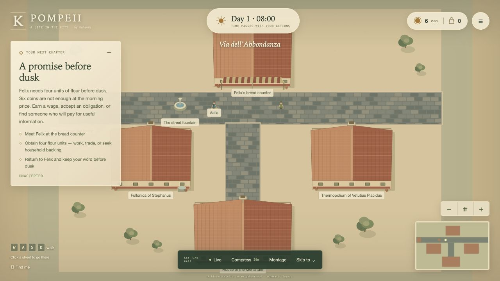
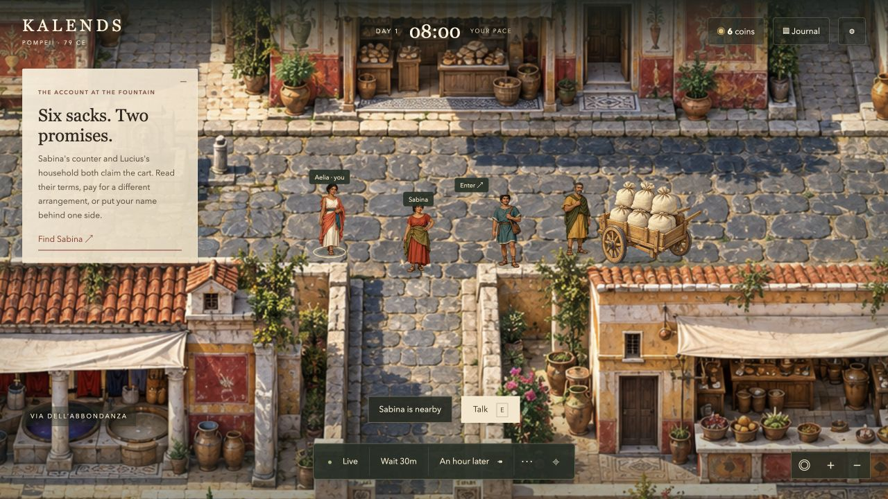

# Kalends: Rebirth — verified playable release

21 October 2026. The delivered game is a small illustrated historical narrative adventure: a disputed cart, three materially different bargains, a connected grievance and recurring funded commissions. It runs offline at **http://127.0.0.1:8782/**. The existing user's life was preserved through the final runtime restart. Earlier Kalends modules, saves and historical studies were retained.

## 1. What actually changed in the playable game

- Original painted street, four painted rooms, six portraits, transparent character atlas and a painted six-sack cart replace the schematic presentation. Canvas remains the renderer after an official-documentation feasibility review; no unfinished engine migration was introduced.
- Full-viewport exploration, smooth path presentation, portrait dialogue, contextual choices, review-before-confirming, paper journal/bag, readable room exits, optional interaction sound, reduced motion and larger-text settings. Secondary inspection lives in World Lab.
- Aelia can investigate two written orders and a withheld loading account; broker a four/two delivery, spend her own coins to prioritize the market, or accept an advance and household service. Ignoring the dispute lets the buyers settle it themselves.
- Each route changes actual goods, money, access, commitments and relationships. A later grievance requires a different costly repair. Reserved-reward commissions and bounded paid shifts connect income, investigation and future standing.
- NPCs pursue bounded state-dependent procurement/plans. Reliability, credibility, affinity and earned favors have distinct uses. Retained shared experiences affect recall; forgotten material is not silently recovered from the archive.
- Public purchase reviews show actual quantity, unit price, total price and availability. Commission reviews show their actual duration and due time. Reliable early resource guards reduce infeasible offers; confirmation remains authoritative and atomic.
- Fixed late context/proposal replies after closing a conversation, overlapping consent saves and the old-room scene persisting during travel between interiors. Chronological recall now selects the kept commission after a week rather than an older offer. Per-command presentation revisions preserve exact earlier Rebirth replay hashes.

## 2. Launch immediately

From `/Users/tanmaygoswami/Claude_backup/Projects/kalends`:

```sh
./scripts/start_rebirth.sh
./scripts/start_rebirth.sh --status
```

Open **http://127.0.0.1:8782/** and choose **Continue as Aelia**. Start with Sabina at the fountain; click to walk, speak and review a choice. Arrows/WASD move, E talks, X leaves a room and J opens the journal. Explicit actions/time controls advance the world; closing the browser does not simulate real elapsed days.

The detached launcher survives its launching terminal closing. Its default journal is `.kalends/rebirth_session.json`, with log/process records beside it. `--stop` stops only a verified owned process and preserves the save. This is local operation, not public hosting or an OS login service. See [local operations](docs/rebirth/LOCAL_OPERATIONS.md).

Foreground and separate unsaved QA alternatives:

```sh
./scripts/run_rebirth.sh
./scripts/run_rebirth.sh --temporary --port 8784
```

Python 3.10+ is required; the scripts find this machine's bundled 3.12 runtime. No runtime dependency install or API key is needed. For an old Pompeii life, use `--migrate-from OLD --journal DIFFERENT_NEW` with the foreground runner. The source journal is preserved and verified before continuation; old service/delivery obligations remain real.

## 3. Actual screenshots and walkthrough evidence





The immutable nine-image baseline retains its original hashes. [Visual QA](docs/rebirth/VISUAL_QA.md) inventories two earlier review passes and the final desktop 1280×720 / responsive 390×844 pass. Final captures include mobile conversation/review/room exit, actual one-week return, retained commission memory, exact deadline, unavailable purchase and successful trade. These are running-game screenshots, not concept mockups. The narrow captures are browser viewports, not physical phones. No video-recording capability was exposed.

The actual broker browser sequence copied both orders, paid for the withheld loading account, negotiated delivery, saw the grievance, accepted/fulfilled a report commission, repaired the relationship, visited all four rooms and executed a World Lab omission. Removing record 24 changed the alternative from nine to five coins and removed broker access; four infeasible later commands were disclosed. The preserved journal is `results/rebirth/browser_walkthrough/before_week.json`.

The final browser continuation exited the household, used **A week**, reached Day 8 and showed Marcus remembering the kept commission and repair. A 12-unit review quoted 24 coins and disabled confirmation. A reviewed one-unit purchase then actually changed nine coins/no flour to seven coins/one flour. `final_browser_journal.json` and `final_browser_audit.json` preserve 19 accepted commands, world minute 10259 and the exact replay hash. QA used separate `/tmp` lives; the user's life was not used for those actions.

## 4. Why there is more to play

The first dilemma trades investigation, money and obligation against one another. Its resolution changes whom Aelia can work with and who expects repair. The recurring loop is: obtain an opportunity, investigate or earn resources, make a funded promise, act before its deadline, then gain or lose standing. Kept promises create access/favors; simply repeating a button does not mint unlimited rewards.

This is a more connected opening and continuation loop, not evidence that players enjoy it or return voluntarily. The game currently has three recurring commission templates and one route-specific repair, rather than a second fully authored dilemma. The strongest content addition is one compact dispute that depends on the first agreement.

## 5. AI that works and AI that remains unconfigured

Offline intent interpretation, explicit choices, grounded authored dialogue, retained-memory recall and bounded NPC policy operate in the game. A provider-neutral subsystem defines six contracts: intent, dialogue, planning, reflection, montage and draft content. Strict schemas, knowledge boundaries, resources, proximity, confirmation, stale-proposal rejection, budgets, timeouts and fallback constrain proposals.

Mock/offline adapters and a tested OpenAI Responses REST transport are implemented; a loopback JSON provider is optional. External inference is disabled in the delivered service. No live model was contacted for game cognition and no live-model conversation quality is claimed. Planning/reflection/montage/content contracts are foundations, not automatically running LLM brains or a generative city. Default simulation policy remains authored and deterministic. See [AI architecture](docs/rebirth/AI_ARCHITECTURE.md), [roadmap](docs/rebirth/AI_ROADMAP.md) and [cost model](docs/rebirth/AI_COST_MODEL.md). Image-generation tool billing was not measured; zero cognition API spend is not zero total sprint cost.

## 6. New experimental result

One completed preregistered study tested historical-event sharing and incremental exact hashing in actual isolated session transactions. At60ordinary world days, median latency fell 24.25→3.85ms; paired geometric gain was6.26× with descriptive95% interval[6.05, 6.46]. All 120 matched histories passed declared equivalence, across 20 seeds, 1/30/60 days and ordinary/conversation-heavy histories. There were 1200 timed transactions and separate memory, replay and rejection checks.

Historical writes were **1.37–2.15× slower**. This trades append work for cheaper transaction copies/hash reads. The result belongs to frozen runtime `3c971b6`; later public-offer/recall/replay fixes were not retimed. The reproduction instructions extract the frozen checkpoint, and that complete source guard was independently rechecked after the release. [Research results](docs/rebirth/RESEARCH_RESULTS.md) links raw rows, registration, verification and the plot.

## 7. What that research does and does not establish

It establishes a local application-level engineering tradeoff with exact declared comparisons. It does not establish hierarchical causal time compression, larger-population scaling, historical social realism, model intelligence or human enjoyment. There are six NPCs. Temporary-session timing excludes journal writes, browser rendering and network transport. Two actual ENOSPC failures stopped the saved-session study; both failures and interrupted records remain preserved. No final durable-endpoint latency claim is made. Later recovered free space and a successful wheel build do not repair the missing storage study.

The [novelty audit](docs/rebirth/RESEARCH_NOVELTY_AUDIT.md) distinguishes ordinary event scheduling, immutable storage and prior agent/narrative work from unproven ambitions. The 23-entry old history ledger and six additional setting notes distinguish archaeological evidence, reconstruction and fictional transactions. The illustrated district is a schematic historical fiction, not a surveyed reconstruction.

## 8. Exact verification

| Check | Result |
|---|---|
| Original baseline `ad979b4` |345 passed in 19.69s|
| Final Python suite, including loopback HTTP |**524 passed in 17.82s**|
| Shipped-client offline Node integration checks |**8 passed, 0 failed**|
| Final cognition contract corpus |**42/42**, no external inference calls|
| JavaScript syntax / source and document whitespace |Passed; raw profiler output retains its original trailing blank line|
| Final wheel |Built; all 19 Rebirth package files byte-matched, entry point verified|
| Legacy/mixed-version journal and causal-fork replay |Passed, including original-runtime pinned memory hash|
| Real browser journal after week and purchase |Replayed exact hash, preserved source bytes|
| Detached launcher lifecycle |Start/reuse/status/stop/restart and save preservation checked; unrelated/mismatched processes left alone|

Commands:

```sh
PYTHONPYCACHEPREFIX=/tmp/kalends-pycache PYTHONPATH=/Users/tanmaygoswami/Library/Python/3.9/lib/python/site-packages /Users/tanmaygoswami/.cache/codex-runtimes/codex-primary-runtime/dependencies/python/bin/python3 -m pytest tests/ -q
node --test tests/frontend/rebirth_client.test.cjs
node --check kalends_rebirth/static/app.js
python3 -m kalends_rebirth.ai_eval --out results/rebirth/NEW_UNIQUE_DIRECTORY
```

`results/rebirth/validation/checks_final.json` pins exact runtime hashes and check scopes; the earlier 478-test checkpoint record remains preserved. Source checks use a Node VM/fake DOM, not a headless browser or physical-device test. The wheel comparison verifies packaged runtime files, not standalone installed research/history documentation routes. No independent human playtest, physical-phone/FPS measurement or forced asynchronous browser race was performed.

## 9. Git and preserved work

Branch: **`codex/kalends-rebirth`**. Milestones:

- `e077f51` — immutable visual baseline and chosen art direction.
- `3c971b6` — illustrated intrigue, grounded cognition and durable continuation; frozen research checkpoint.
- `2c5d9a1` — final playable/runtime polish, public offers, chronological recall, compatible replay, client regressions and detached launcher.
- The subsequent evidence/handoff commit contains this document, raw results and capture manifests; inspect `git log -4 --oneline` for its exact identity.

Old `kalends/` source, prior study directories and the baseline were preserved. Runtime code is in `kalends_rebirth/`; shared packaging adds the new entry point/assets. Nothing was pushed or publicly deployed. The main owned service remains 8782; separate 8785/8787 QA services were stopped with their journals preserved.

## 10. Biggest next improvement and unfinished scope

Run the prepared **six formative / twelve uncoached first-session and 72-hour optional-return protocol** with actual consenting players. No participants have been contacted. Repair observed comprehension/friction before scaling content or buying model calls. The current local note stream is opt-in, bounded and local; missing build/session/idle identifiers prevent unaided retention analysis.

Then author one second dilemma linked to the first route and measure authoring effort. Improve state-specific language and punctuation; current recall is a literal selection of retained records. Layer foreground architecture/furniture, add fuller directional animation and test on real phones. Camera/actor presentation is improved, but scene paintings do not yet supply foreground occlusion masks or furniture collision. Voice, unrestricted generated lives, large populations, creator tools and a marketplace remain future work.

Use [next thirty days](docs/rebirth/NEXT_30_DAYS.md), [next-agent prompt](docs/rebirth/NEXT_AGENT_EXECUTION_PROMPT.md), [product validation](docs/rebirth/PRODUCT_VALIDATION.md), [company strategy](docs/rebirth/COMPANY_STRATEGY.md) and the [four-perspective review](docs/rebirth/ADVERSARIAL_RELEASE_REVIEW.md). The deliverable is the working local game and its verified consequences; these notes record its evidence and limits.
