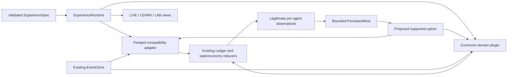

# Experience OS: compatibility architecture

This is an opt-in experience lifecycle over existing Kalends mechanisms. It adds a strict authoring boundary, a second domain plugin, persistent next-step cognition, a temporal facade, and shared participant/learning/operator interfaces. It does not replace the old world engines or migrate existing saves into changed behavior.

## 1. Audit: what was duplicated and what is actually shared

| Existing layer | Mechanisms present before Experience OS | Treatment in this change |
|---|---|---|
| `kalends/events.py`, `world.py`, `observation.py`, `memory/base.py`, `rng.py` | Append-only event identity/history; canonical state projection; scope/location observation routing; admitted Experience records; contextual deterministic randomness. | Reused. No new event format, general state reducer, observation oracle or random-number stack. |
| `kalends/city/simulation.py` | City state, economy projection, event emission, private experiences, decisions, pending messages and tick-oriented interventions. | `CoordinationWorld` reuses `CitySimulation._emit`; it does not run the city's grain-policy initializer. Existing City experiments keep their original classes and tick rules. |
| `kalends/genesis/simulation.py` | Extends City with a player, bounded operational retention, paid checks, backed commitments, relationships and an extended economy reducer. | The existing `GenesisEconomy`, itself an extension of `CityEconomy`, supplies finite accounts and event-applied cash/commitment effects to both current adapters. |
| `kalends/pompeii/world.py` and `temporal.py` | A separate domain wrapper over Ledger/WorldState/GenesisEconomy; embodied movement, local observations, retained memories, commitments and a stable minute-based `EventClock`. | Retained. Its event emission has domain-specific observation and remembrance hooks; this was not forcibly merged with City's emitter. Its exact scheduler is the common OS clock. |
| `kalends_rebirth/world.py`, `cognitive_market.py`, `minds.py`, `server.py` | Adds the cart story, document access, recurring funded work, relationship axes, legacy V2 cognition, immutable-ledger optimization, reviewed language/actions and accepted-command sessions. | `ExperiencePompeiiWorld` subclasses `RebirthWorld`; `PersistentMind` extends the existing `AgentMind`. The 3D protocol reuses a `RebirthSession` facade. Existing legacy class behavior and session files remain separate. |
| Legacy server/static packages | Similar HTTP/serialization, action-journal, player/operator view and browser-controller patterns across releases. | A small OS service owns new experience journals and translates the shipped 3D routes. Old servers are not consolidated or removed; their established replay/research contracts remain intact. |
| `kalends_rebirth/ai.py` and `language.py` | Provider-neutral task contracts, offline/mock/OpenAI/local adapters, bounded concurrency, timeout, cache, budget accounting, scoped dialogue and reviewed intents. | Reused directly. `providers.py` adds bounded selection validators and realizes literal permitted content; it contains no new network transport. |

The remaining duplication is deliberate compatibility debt: several scenario emitters, serializers and journal wrappers still exist. The new layer establishes a reusable boundary for future experiences; it does not claim to have rewritten all historical packages around a single concrete base class. Old research is reproducible against its own frozen implementation.

## 2. Conceptual interfaces and concrete owners

[contracts.py](../../kalends/experience_os/contracts.py) contains structural Python `Protocol` definitions. They document supported methods; they are not runtime-enforced schemas or a second framework requiring inheritance.

| Contract | Concrete implementation and responsibility |
|---|---|
| **World** | `ExperiencePompeiiWorld` and `CoordinationWorld`: expose `ledger`, `state`, `economy`, `clock`, `minute`, `on_task()` and `fidelity_state()`. Own truth and execute domain rules. |
| **AgentMind** | `PersistentMind` in `minds.py`: `observe()`, `cycle()`, `evaluate()`, retained evidence identities and serialization. Owns bounded cognition, not canonical reality or direct mutation authority. |
| **TimeEngine** | `TemporalEngine` in `temporal.py`, also exported as `TimeEngine`: wraps the existing `EventClock` and the world's task handler. |
| **Experience** | `ExperienceRuntime`: validated spec, instantiated world, accepted commands, `commit()`, `save()`, `snapshot()`, grounded `debrief()` and replayed `fork()`. |
| **ExperienceCompiler** | `ExperienceCompilerV1`: `validate(mapping)`, `load(path)` and `compile(spec_or_path, **runtime_options)`. Validation returns a copy-based `ExperienceSpec`; compilation lazily creates `ExperienceRuntime`. |
| **WorldInspector** | The runtime's `events()`, `trace()` and `snapshot(operator=...)`. Participant inspection is visibility-filtered; explicit local LAB inspection exposes canonical state and private mind state. |

The foundational projection path is:

An agent's selected option must return to its world validator and produce an actual receipt. A trace saying “Act” is an execution handoff, not evidence that an action happened. Canonical history is available to operator inspection and replay; it is not an implicit actor memory store.

## 3. Compiler V1 is intentionally finite

The two checked-in specifications are [Pompeii Life](../../specs/pompeii_life.json), a 120-day setting, and [Shared Observatory](../../specs/shared_observatory.json), a 90-day coordination setting. Both are JSON; no expression evaluator, script callback or arbitrary state patch exists in the schema.

Each specification contains version/id/title, adapter and rules, participants with roles and initial resources, one institution, information boundaries, goals/prerequisites, available actions, dated opportunities, horizon/termination, measures, debrief/transfer configuration and source labels. Unknown fields are rejected throughout rather than ignored as executable extensions.

Validation checks identities and references, duplicate declarations, finite bounded numbers, bool-versus-number confusion, goal cycles, incompatible prerequisite deadlines, incompatible horizons and supported actions/metrics. File loading rejects duplicate JSON keys, nonfinite constants and files above 2 MB. The compiler does not prove arbitrary economic feasibility or infer arbitrary causal effects from prose.

**Pompeii adapter restrictions:** Player and the six existing NPC identities are fixed. Initial cash/flour declarations must match the actual post-Rebirth initialization, including the real cart advances. The household institution describes the existing 120-minute service rule; it does not grant a new arbitrary institution. Authored initial observations must be empty because the retained world initializer owns the actual private evidence. Horizon days and minutes must agree, within the existing 365-day bound.

Pompeii actions come from the shipped reviewed action registry plus movement and wait. Setting rules configure the existing world; opportunities become actual dated participant events. The spec's Pompeii goal labels/targets express experience objectives and debrief context. NPC procurement/duty goals are still supplied by the explicit role-policy bridge, not a general interpreter for arbitrary authored Pompeii goals. Do not infer an additional executable objective tracker from the presence of JSON goal fields.

**Commons adapter restrictions:** identities are Player plus `team_a`, `team_b` and `team_c`. Initial resources are finite inspection credits; the initial pool cannot exceed 400. The one supported institution is `consortium` with rule `coordinator_quota` and declared capacity. V1 rounds are 1,440 minutes, with bounded capacity, quota, cost, round count and maintenance interval. The horizon must equal round count × round duration.

Exactly one authored initial direct hardware-condition observation is permitted, at minute zero, for `team_b`, matching the configured stable/fragile condition. Testimony requires an executed sharing action. Commons project targets require a supported capacity quantity and `completed_rounds` metric; impossible dependency timing is rejected. Named roles and narrative labels are metadata, not code.

Sources are explicitly `fiction`, `reconstruction` or `primary`, with `https` or `project` references. A local project description cannot be labelled a primary external source. The validator checks the source contract and references, not the historical truth of arbitrary linked text; domain experts still have to assess a new experience's content.

`ExperienceService.add()` revalidates direct inputs, refuses an occupied identity with a different spec hash and limits the local demonstration to eight lives. A genuinely new authored configuration needs a new experience identity. A provider suggestion is not a way around these checks.

## 4. Shared Observatory is a domain plugin, not another state engine

[commons.py](../../kalends/experience_os/commons.py) subclasses CitySimulation only to reuse its event projection mechanism. It explicitly initializes the existing `Ledger`, `WorldState`, `GenesisEconomy` and `EventClock`. Domain records are finite JSON values in existing `experience.*` propositions. There is no additional general reducer, alternative event ledger or independent time queue.

Three research teams request access to one instrument. Nominal capacity is 12 and quota is four in the reference spec. A fragile instrument has only two-thirds usable capacity, so promises based on the nominal total can fail later. The condition persists over the configured maintenance window; seeded condition changes occur at window boundaries. Team B receives the direct report privately, while other actors must inspect or receive a report.

The coordinator reviews and commits an allocation and may promise a quantity to a team. Inspection transfers owned finite credits to the consortium account. A round's actual allocation settles once, one minute before the next day. Execution uses the public fixed order A, B, C, not a fairness optimizer or a multi-party voting system. Promises produce kept/missed receipts and relationship effects after actual execution. Six completed projects qualify the coordinator for the explicitly authored membership threshold.

Project goals are registered with absolute deadlines and active/blocked/completed/missed states. A target is fulfilled by enough actually settled units in one batch; a request or promise does not complete a project. Prerequisites must already have completed before that batch: the same settlement cannot establish a prerequisite and simultaneously claim its dependent project. Completed or expired projects do not silently renew; subsequent regular institutional work is represented separately.

NPC requests come from bounded mind decisions over retained condition evidence, current own credits and explicit options. The policy is authored: supported full request, cautious request, paid inspection or wait. It is not open-ended model negotiation. A blocked project cannot independently request its work.

Sharing preserves a report's dated value and original source lineage through relays. The sender must have observed the event; an NPC must still retain it. A participant request for Team B's report makes that NPC disclose an actual retained report; it does not grant the participant an archive query. Repetition does not create a new firsthand witness. Fresh inspection is a new paid direct observation.

Declared opportunities are scheduled actual events. They can prompt reconsideration but do not magically execute a player's best response. A long trajectory therefore consists of accepted allocations, real settlements, evidence disclosures, obligations and membership changes, rather than an invented biography attached to a late calendar date.

## 5. Minds V3 and its observation boundary

[minds.py](../../kalends/experience_os/minds.py) extends `kalends_rebirth.minds.AgentMind` with `PersistentMind` and a Pompeii compatibility bridge. The existing episode, belief, action-option, goal and social-signal contracts remain the typed substrate.

The loop exposes Observe → Encode → Retrieve → Update Beliefs → Select Goals → Plan → Act → Evaluate → Consolidate. A pending plan records one supported next action, supporting evidence, due time, an option fingerprint and revision/outcome state. At most four plans survive. Only explicit host execution feedback can mark a current pending plan succeeded, failed or cancelled.

Defaults allow 32 memory records and eight records in one decision context. Episodes, semantic/social records, revisions and inferred consolidation share the memory budget. Goals, the last decision and four plans are separately bounded working state and are included in serialized-byte accounting. Consolidation is a heuristic assessment of surviving witnessed signals, not a new eyewitness account; it creates no invented source event.

In newly compiled Pompeii lives, all six NPCs receive V3 minds. The bridge admits only newly available records from that actor's existing `remembered()` stream, with a monotonic ingress watermark. It can read the actor's own cash, stock, location, role and current time. It does not read another actor's memory, private documents or the dispatch archive to formulate that actor's beliefs.

An old admitted document whose structured value exceeds the atomic fact contract remains a bounded literal episode; the bridge does not guess a new proposition by truncating JSON. An evicted record is not re-admitted just because it remains in a canonical ledger. A later legitimate report or inspection can provide new evidence.

The runtime schedules V3 decisions at the existing procurement opportunities and additional assigned-duty opportunities. The supported action registry returns to existing purchase, inspection, routine or gossip rules. Legacy Rebirth worlds retain their original behavior and activation contracts. The optional model proposal helpers do not replace this deterministic default loop.

## 6. Time semantics and honest compression limits

[temporal.py](../../kalends/experience_os/temporal.py) wraps the existing stable heap clock. World time is integer minutes; it is neither real elapsed participant time nor a measure of subjective experience.

| Mode or strategy | Actual behavior |
|---|---|
| `live` | Exact integer-minute reference scanning. The facade has no wall-clock display loop. The shipped 3D controller separately requests ordinary timed advances when its Live control is active. |
| `compress` | Visit scheduled task minutes and the target. All ordinary causal handlers execute in stable order. |
| `montage` | Execute the same exact transitions, then separately select supplied accessible actual events for a condensed presentation. |
| `skip` | Advance to an explicit target or the next queued task; it does not invent omitted life events. |
| `naive` strategy | Round task execution up to a coarse grid. Tasks remain, but lateness and changed within-bin reactions can diverge from the reference. |
| `adaptive` strategy | Elide only intermediate, explicitly contracted observation-free presentation assignments, retaining the terminal assignment before a semantic/dependency barrier. Unknown or semantic tasks remain exact. |

Significance is an authored conservative scoring function over event categories and explicit effects: obligations, shortages, belief/goal/institutional changes, relationships, decisions and new information. It does not parse titles into invented causal facts. Unknown non-cosmetic events remain potentially consequential. A small montage can omit records from its presentation without omitting their world effects or deleting them from history.

Adaptive omission requires trusted `presentation.*` write declarations, no reads, no observers, no scheduling, no semantic effects and idempotent assignment. The facade checks queue/clock and ledger mutation on retained contracted handlers; an optional semantic probe checks additional state. A contract violation stops with an audit, but direct facade use does not roll back a handler that already violated the contract.

These declarations are not inferred proofs about arbitrary Python. Ordinary OS worlds register no automatic safe-to-ignore semantic tasks; their adaptive execution therefore keeps their consequential work. A custom presentation fixture can demonstrate handler omission, but that does not establish a general multi-agent speedup. Fidelity and cost measurements are reported separately in [RESEARCH_RESULTS.md](RESEARCH_RESULTS.md).

## 7. Continuity, accepted commands, checkpoints and alternatives

[runtime.py](../../kalends/experience_os/runtime.py) owns a separate experience journal. Runtime version, spec hash, the full validated spec, retention configuration, revisioned accepted commands and the final state hash are saved. The state hash includes canonical domain state, scheduler, bounded minds and the ledger content hash.

`commit(operation, data)` acquires the runtime lock, deep-copies the world, performs the action/advance on the trial, records the accepted command and saves the trial before replacing the live world. Invalid actions and persistence failures therefore do not partially adopt the trial into the original runtime. Temporary-file replacement provides an atomic file update; this is not a distributed transaction or a guarantee against every filesystem/power-loss failure.

Every command records its revision, operation, payload, starting minute, resulting minute and receipt identity. Restart reconstructs the configured initial world, executes the accepted commands, checks their timing/receipt metadata and verifies the final state hash. A mismatch raises an error and preserves the input journal rather than silently starting a new life. Replay is reconstruction, not a hidden runtime query into an actor's memory.

`ExperienceService` uses an in-process lock and the server holds an exclusive POSIX writer lock for its selected directory. This prevents two instances of that server from writing the same directory; it does not provide multi-host consensus or lock every possible direct Python caller. Journals default to `.kalends/experience_os/`, separate from original Rebirth/Immersion saves. Compiling a new life does not mutate or automatically import those saves.

`fork(command_index)` omits one actual accepted player action, starts a separate runtime, and replays later declared commands at their recorded times where feasible. Later infeasible actions are explicitly listed. It does not write back to the original journal. The comparison tests this omission under fixed later commands; it is not an optimal alternate biography, a minimal-cause proof, or a causal claim inferred from prose.

Dependency inspection follows recorded parent IDs, respecting participant visibility and counting hidden parents without disclosing their contents. Accounting/provenance support and an executed intervention are different kinds of evidence; the UI labels the distinction.

## 8. LIVE, LEARN and LAB use the same accepted history

Run `python -m kalends.experience_os.server --port 8800 --directory .kalends/experience_os` in the supported Python environment. The server binds loopback. The existing 3D client's production bundle must already be built to use `/immersion/`; it is mounted from the PlayCanvas client without a graphics rewrite.

The console at `/` selects a compiled experience and exposes three views:

- **LIVE:** review/confirm instrument allocations, reports, checks and promises, or enter the existing 3D Pompeii client. `ExperienceGameFacade` binds the shipped Rebirth dialogue/route protocol to the *same selected compiled Pompeii life*, including an authored life with a new identity; confirmed 3D actions enter that runtime's journal.
- **LEARN:** show accepted choices, accessible consequential receipts, actual metrics, authored reflection questions, one formative transfer item and an optional executed omission retry. It does not claim measured human learning.
- **LAB:** deliberately expose world truth, retained beliefs/episodes, plans, decisions, command history, the spec editor and causal inspection. Changing the view does not create a separate world or retroactively grant NPC knowledge.

Participant routes include `/os/catalog`, `/os/state`, `/os/debrief`, `/os/trace`, reviewed `/os/propose` → `/os/confirm`, `/os/advance`, `/os/fork`, `/os/assessment` and the compiler endpoints. The full author spec is available only after explicitly selecting local LAB, because it contains private initial conditions.

`/os/assist` accepts a supported task, not caller-provided world truth or an evidence dump. The service derives up to 24 current participant-visible clauses and admitted IDs, or validates proposed plan availability on an isolated trial world. The returned suggestion does not count as a player command. The host still requires an ordinary reviewed, current-state-validated action before any mutation.

The old `/api/state`, `/api/context`, `/api/route`, `/api/propose`, `/api/act`, movement and time routes bridge the existing 3D client. Generic and 3D proposals carry state fingerprints, so time or another accepted action can make them stale. New private report contents appear after confirmation, not inside a trial preview.

The small [game-host.js](../../kalends/experience_os/static/game-host.js) adapter wraps the unchanged 3D HTTP bridge. The explicit iframe URL `/immersion/?experience=<id>` supplies the life identity; root-relative `/api/` requests receive that query parameter while existing recipient queries, POST bodies and asset requests remain intact. No cookie or global active-world setting can redirect another tab's commands to a different journal. Successful game POST responses send a same-origin, life-labelled parent refresh signal; the console checks origin, frame identity and selected life. That signal is not itself an accepted-command receipt, and the adapter does not consume or replace the bridge's response body.

This is a local single-operator demonstration, not an authenticated multi-user authorization system. A user who deliberately enters LAB can inspect private state. Loopback binding, Host/Origin checks, bounded requests, static path containment and CSP reduce unintended web access; they do not turn query parameters into user authentication. The embedded game notifies its parent console; other browser sessions still require refresh to observe changes.

## 9. Optional AI assistance and extension boundaries

[providers.py](../../kalends/experience_os/providers.py) reuses `Cognition`, `Language`, existing task policies, transports, timeout/cache/usage accounting and explicit provider budgets. Default `ExperienceProposals()` and the server remain offline. `--configured-ai` explicitly opts into the existing environment configuration; the old external-enable, key/model, price and positive-budget gates still apply. Offline and injected transport fixtures are not live-model evaluations.

The helper API is proposal-only: `draft_spec(prompt, templates)` chooses a validated template and authored objective focus; `debrief(context)` selects literal supplied feedback/questions; `suggest_plan(context)` chooses a supplied enabled option with its exact support or wait; and `consolidate(context)` proposes literal admitted memories. A draft is compiler-validated but is not instantiated automatically. No helper can invent executable rules, install memories, expose an unprovided archive record or enact a selected action.

Evidence contexts require an explicit actor/viewer, world minute, supplied clauses and admitted event IDs. Unknown fields, future/foreign records and unsupported citations are rejected. Context hashes help identify the exact proposal scope; the host must still validate freshness and authoritative preconditions when a suggestion is used. This is bounded selection assistance, not unconstrained reflective narrative or general natural-language world generation.

To add a **third substantive adapter** without creating another engine:

1. Define the small domain's resources, action validators, observation scopes, task handlers, terminal conditions and outcome measures. Separate renewable per-round capacity from conserved owned balances.
2. Reuse Ledger/WorldState and the existing economy/clock. Express domain facts as validated projections; do not add an alternate general state reducer or a second scheduler.
3. Add the adapter to the compiler's explicit rules/identity/action/metric registry. Reject unknown effects and incompatible goals/time. Provide a real source-labelled spec and an executable fixture.
4. Implement the World contract and adapter selection in `ExperienceRuntime._new_world()`, plus the domain's authoritative action dispatch and participant projection. Expose only legitimately admitted episodes to `PersistentMind`; a model's proposed option must return to the same domain validator.
5. Supply a participant view, grounded debrief and inspector mapping using the same accepted-command history. Rendering is replaceable; a text interface can prove a new domain before 3D assets exist.
6. Add exact restart, invalid-command rollback, finite-resource conservation, private-observation/relay, goal/deadline, omission-preservation and temporal-reference tests. Record a genuinely different accepted trajectory; a renamed resource with no different decision structure is insufficient.
7. Version changed behavior and journals deliberately. Preserve old specs/research/saves, and fail clearly on unsupported revisions rather than silently reinterpreting their history.

Current limits are explicit: two finite adapters, authored policies/options, no arbitrary institution creation, no distributed persistence, no continuous background simulation while the server is stopped, no automatic validated curriculum generator, no measured learning transfer and no subjective-time acceleration. The reusable contract is functional; its generality and product value need independent third-experience and human-use evidence.
