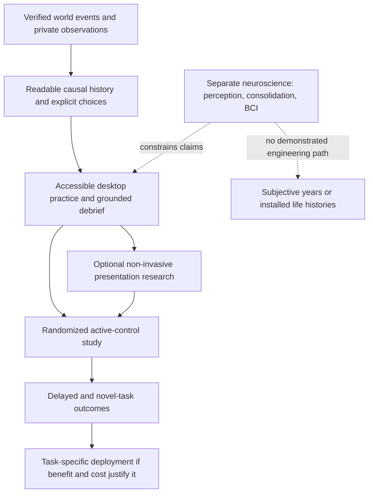

# Kalends: a testable synthetic experience platform

Research and strategy review, 24 October 2026. This is a development thesis and a proposed human-study protocol, not evidence of adoption, learning efficacy, neurological acceleration, or clinical benefit.

Kalends' defensible near-term proposition is a reusable, inspectable runtime for consequential decision experiences: author rules and information boundaries, execute choices against real simulated resources, preserve their history, and compare explicit alternatives. Pompeii is one presentation. Shared Observatory tests whether the same continuity, memory, clock and inspection mechanisms support a different task.

The present slice still has two finite domain adapters and authored action options. It does not compile arbitrary societies, invent reliable curricula, or give citizens unrestricted autonomous intelligence. Structured specifications are an authoring boundary; they are not a natural-language world generator.

## 1. Scientific position and verified related work

Sources below were checked against original papers, their publisher records, or official research repositories. The version dates matter: later revisions sometimes add experiments absent from earlier audits. Reported results from other authors are not Kalends results, and numerical rankings across unrelated tasks are not comparable.

| Original source | Actual method or evaluation | Consequence for Kalends |
|---|---|---|
| He et al., **MemoryArena: Benchmarking Agent Memory in Interdependent Multi-Session Agentic Tasks**, arXiv:2602.16313, v2, 17 September 2026. [Paper](https://arxiv.org/html/2602.16313v2) | Interdependent sessions couple acquired experience to later task execution in web shopping, search, constrained travel planning and formal reasoning. Evaluates long context, external memory, BM25, semantic embeddings and structured retrieval; additional memory is not universally beneficial. | Executed memory-dependent behavior is already an established evaluation target. Kalends needs matched observation and decision budgets, dependency-depth tests, and negative results rather than a claim to have invented memory-to-action evaluation. |
| Zhao et al., **AMA-Bench: Evaluating Long-Horizon Memory for Agentic Applications**, arXiv:2602.22769, v4, 27 May 2026. [Paper](https://arxiv.org/html/2602.22769v4) | Real and synthetic state/action/observation trajectories support recall, causal reasoning, updating and abstraction questions. AMA-Agent builds a causal graph with tool-assisted retrieval. The primary evaluation uses fixed-trajectory QA; this revision also reports downstream TextWorld and Spider2 execution experiments. | Calling the benchmark “only QA” is inaccurate. A future Kalends comparison must separately measure state representation, retrieval and executed policies, including model and construction cost. |
| Shen et al., **Mem2ActBench: A Benchmark for Evaluating Long-Term Memory Utilization in Task-Oriented Autonomous Agents**, arXiv:2601.19935, v1, 13 January 2026. [Paper](https://arxiv.org/html/2601.19935v1) | Synthesizes evolving, interrupted assistant histories and tests implicit memory use for tool selection and argument grounding. Includes 400 tool-use tasks and evaluations of seven memory frameworks. | Grounding an action's recipient, quantity and current constraints matters independently of fluent recall. Kalends' authoritative receipts add a useful domain-specific measurement, not a replacement benchmark result. |
| Latimer et al., **Hindsight is 20/20: Building Agent Memory that Retains, Recalls, and Reflects**, arXiv:2512.12818, December 2025; published demonstration **Hindsight: Structured Agent Memory that Retains, Recalls, and Reflects**, ACL 2026, pp. 275–285. [Preprint](https://arxiv.org/html/2512.12818v1), [published record](https://aclanthology.org/2026.acl-demo.27/) | Separates world, experience, observation and opinion networks. Retain/recall/reflect combine temporal/entity structure with vector, lexical and graph retrieval. Its published systems and conversational benchmarks use components absent from Kalends. | Evidence/belief separation, temporal memory and reflection are prior art. V3 is a small deterministic mechanism study, not a Hindsight implementation or demonstrated competitor. |
| Kassner et al., **BeliefBank: Adding Memory to a Pre-Trained Language Model for a Systematic Notion of Belief**, EMNLP 2021, pp. 8849–8861. [Paper and metadata](https://aclanthology.org/2021.emnlp-main.697/) | Stores symbolic beliefs, revises inconsistent answers with weighted MaxSAT, and supplies known beliefs as feedback to later model queries. | Explicit revisable beliefs are not novel. Kalends uses dated admitted evidence and heuristic revision; it does not implement this logical solver or establish comparable belief consistency. |
| Yao et al., **ReAct: Synergizing Reasoning and Acting in Language Models**, ICLR 2023, arXiv:2210.03629. [Paper](https://arxiv.org/abs/2210.03629) | Interleaves model reasoning, environmental actions and new observations. | V3 exposes a traceable observe/plan/execute-feedback boundary. Its authored option scoring is not ReAct's model-driven reasoning loop. |
| Shinn et al., **Reflexion: Language Agents with Verbal Reinforcement Learning**, NeurIPS 2023, arXiv:2303.11366, v4. [Paper](https://arxiv.org/abs/2303.11366) | Retains verbal reflection on feedback to improve subsequent attempts without changing model weights. | V3's bounded, evidence-linked social assessment and explicit success receipt are narrower than verbal reflection over general tasks. A successful receipt is execution feedback, not learned general competence. |
| Park et al., **Generative Agents: Interactive Simulacra of Human Behavior**, UIST 2023, arXiv:2304.03442. [Paper](https://arxiv.org/abs/2304.03442) | A model-driven architecture stores natural-language experiences, retrieves them, reflects and plans behavior in a small interactive society. | Persistent social agents, recency/importance/relevance retrieval and reflection already exist. Kalends emphasizes finite retention and authoritative causal/economic checks; believability and autonomy still require independent evaluation. |
| Packer et al., **MemGPT: Towards LLMs as Operating Systems**, arXiv:2310.08560, v2, February 2024. [Paper](https://arxiv.org/abs/2310.08560) | Uses explicit memory tiers and control flow to manage a model's limited context. | “Operating system” is a design metaphor, not a novelty argument. Kalends deliberately forbids a forgotten actor record from being silently restored through canonical history. |
| Xu et al., **A-MEM: Agentic Memory for LLM Agents**, arXiv:2502.12110, v11, October 2025. [Paper](https://arxiv.org/abs/2502.12110) | Generates structured notes and dynamically links and revises a Zettelkasten-inspired memory network. | V3 has no equivalent model-created semantic note network or dense retriever. Testing a hand-written structured policy against simple retention arms cannot establish superiority over this system. |

The plausible research contribution is a reproducible *combination*: private observation eligibility, bounded retained evidence, delayed funded obligations, exact command replay, counterfactual retries, and explicit experience objectives. Each component has substantial prior art. Two adapters demonstrate reuse, not generality across arbitrary domains.

Current V3 extends the existing AgentMind: episodes, dated beliefs, source lineage, bounded goals, up to four persistent next-step plans, explicit execution feedback, and grounded heuristic consolidation. Defaults retain 32 records and supply eight records to a decision. Plans and goal working state have separate disclosed bounds; serialized bytes must count them. There is no trained mental model or evidence that the simulated agents are conscious.

Recency, salience, goal relevance and hybrid retention are mechanism baselines. Hashed bag-of-words remains a lexical baseline. It must never be labelled a competitive dense embedding model. A modern comparison requires a pinned embedding model, recorded vector footprint and inference/embedding cost, the same admitted observations, and the same downstream action policy. If unavailable locally or not authorized within a budget, record that arm as unexecuted.

## 2. Three research questions and stopping rules

**A — Persistent cognition.** Test whether a memory change alters executed choices and social consistency after equal access to the same observations. Hold environment seeds, action options, available resources, memory/context budgets and inference policy fixed. Include contradictory dated reports, repeated ancestry, forgotten personal dealings, deadlines, altered goals and long gaps. Split an action error from a legitimately false belief: an actor cannot be expected to know evidence it never observed.

Use the existing V2 mind, recency, salience, goal relevance, hybrid V3, no-revision, no-lineage and no-consolidation arms where implemented. Report completed work, resource loss, costly checks, missed/kept promises, stale-belief actions, independent-source errors, plans revised after valid evidence, invalid attempts and total state bytes. Show seed-level paired differences and uncertainty; scenario variants are not independent people. A gain entirely explained by avoiding inspection fees is a narrow economic result. A tie is a result.

**B — Causal time compression.** Compare fine-resolution reference execution, the existing exact event scheduler, a declared coarse baseline and the adaptive adapter under matched commands and seeds. Measure processed tasks, CPU/wall time, peak memory, event volume, state hashes, consequential-event recall, belief differences and executed-action divergence. Exact scheduling may remove display/poll overhead while executing every causal task. Montage selects existing events; it does not itself accelerate computation.

Approximation is a separate contract. A skipped transition can affect an obligation later. Require explicit write sets, conservative triggers and a fallback/refinement policy; compare the result with a full reference rather than assuming low significance means causal irrelevance. If the adaptive method retains every consequential task and gains little speed, report that. Faster simulated dates are not evidence of a better world model.

**C — Experiential effectiveness.** The technical system can present information, choices, delayed receipts, cited debriefs and retries. Whether people learn more than from a cheaper alternative is unknown. The next section defines a prospective test; no human recruitment, learning outcome or retention result is represented by automated playthroughs.

Actual executed runs, raw data, source fingerprints and limitations belong in [RESEARCH_RESULTS.md](RESEARCH_RESULTS.md). This thesis does not predeclare their outcome. Memory correctness tests and a 90-day world trajectory are necessary engineering evidence; they are not human-study samples or ecological validation.

## 3. A human evaluation worth running

**Target:** coordinate shared scientific-instrument capacity under dated private information, limited inspection funds, multiple legitimate deadlines and enforceable promises. The skill is cost-aware evidence use and feasible coordination. The observatory's credits, capacity reductions and teams are authored experimental rules, not an accredited astronomy curriculum.

**Prerequisites:** complete a small usability pilot with consenting adults, resolve instruction ambiguity and accessibility failures, obtain the applicable institutional ethics review before research recruitment, and preregister hypotheses, items, scoring, exclusions and analysis. Pilot participants do not enter the confirmatory efficacy analysis. Recruit through an appropriate research partner; this document authorizes no outreach or data collection.

1. **Pretest, 8 minutes:** use a different shared-resource vignette. Participants choose a dated report to inspect, produce a numeric allocation and promises, state their uncertainty and identify a possible revision trigger. Include correlated testimony and a priced information option. Counterbalance parallel item forms rather than repeat identical questions.
2. **Randomization:** assign individuals to two arms, stratified by pretest band and relevant experience. Keep the allocation concealed until enrollment; retain assignment in an audit record. Avoid assigning classmates in a way that allows cross-arm coaching during the session.
3. **Experience arm, 25 minutes:** run several consequential Shared Observatory rounds. Participants can seek legitimate reports, pay for checks, commit, allocate, see actual delayed outcomes, and review a cited debrief. A retry shows the same initial state with a changed accepted decision. Do not show private LAB truth before the primary decision.
4. **Matched active control, 25 minutes:** use an interactive casebook containing the same mechanics, facts, report-access options, numerical decisions, receipt examples, feedback volume and debrief concepts. Require predictions and allocations. It must be a plausible useful lesson, not passive irrelevant reading. Log access/time in both arms and expose the same evidence availability; keep presentation style and facilitator contact comparable.
5. **Immediate assessment, 10 minutes:** evaluate an unseen allocation problem without help. Use different names, budgets, condition probabilities and deadline order. Score the decision, evidence selection and justified revisions; the three-option in-app item is a formative prompt only and is not the primary learning endpoint.
6. **Delayed transfer, 7 days:** use a new community fabrication-lab problem, including a changed resource constraint and two reports with shared ancestry. Require a fresh allocation, a feasible promise and a revision after new information. Record attrition and intervening exposure. This is near/domain transfer; it does not establish performance in a real workplace.

**Primary endpoint:** the delayed novel-task decision score, pretest-adjusted. Fix an outcome rubric before seeing arm labels: allocation feasibility, resource/deadline accounting, distinguishing dated direct evidence from duplicated reports, and appropriate revision under the supplied costs. Do not reward inspection unconditionally; checking is only useful when its expected decision value exceeds its cost. Use identical mechanistic scoring where possible and two blinded human assessors for explanations; report agreement and adjudication.

**Secondary endpoints:** immediate transfer, confidence calibration, costly avoidable errors, feasible fulfilled promises, task time and a separate experience-rating measure. Measure fluency and enjoyment separately from learning. Preserve decisions and cited evidence so a correct answer based on a lucky guess is distinguishable from supported reasoning.

**Analysis:** intention-to-treat assignment, a preregistered pretest-adjusted contrast with a confidence interval, and transparent missing-data/attrition sensitivity analysis. Publish all prespecified outcomes, not only favorable ones. With a provisional standardized effect of 0.5, a simple two-arm 80%-power/5%-two-sided calculation suggests roughly 64 completed participants per arm; 20% attrition would imply about 160 recruited. These are planning assumptions, not a validated power analysis for this rubric. Recompute from pilot reliability and the smallest worthwhile effect before enrollment.

The first comparison estimates the *whole interactive-experience package* against an active casebook. It does not isolate agency, repeated practice, debriefing and counterfactual replay. A later 2×2 study can vary interaction and grounded debrief independently if the first effect justifies the extra sample. No positive result should be generalized to subjective time acceleration, clinical treatment, or broad intelligence gains.

**Decision gate:** continue training claims only if the confidence interval supports a practically worthwhile delayed benefit at an acceptable authoring/facilitation cost, without a material increase in harmful confidence. Otherwise improve the experience or sell it as an authoring/research tool with narrower claims. A null human result does not invalidate accurate simulation, but it changes the product proposition.

## 4. Neurotechnology and the original long-term ambition

Four different quantities must remain separate: simulated calendar time, compute time, real participant time, and perceived duration. A world can advance four months through event execution while a person observes twenty minutes of selected history. That person has not acquired four months of ordinary perception, practice or autobiographical memory.

| Question and verified primary research | What the evidence supports | Kalends dependency and boundary |
|---|---|---|
| **Subjective duration:** Stetson, Fiesta & Eagleman (2007), *Does Time Really Slow Down during a Frightening Event?*, PLOS ONE 2:e1295. [Original study](https://journals.plos.org/plosone/article?id=10.1371/journal.pone.0001295) | Retrospective duration expansion occurred without improved perceptual temporal resolution in that task. | Duration judgment is not an extra processing channel. This supplies no basis for deliberately inducing fear or claiming years of cognition in minutes. |
| **VR duration estimates:** Mullen & Davidenko (2021), *Time Compression in Virtual Reality*, Timing & Time Perception 9:377–392. [Original article](https://brill.com/view/journals/time/9/4/article-p377_377.pdf) | An initial-block difference in produced intervals occurred, with strong order/anchoring concerns when display conditions switched. | If ever tested, collect ordinary duration estimates and real exposure time separately. Feeling that time passed quickly is not additional learning. |
| **Replication limits:** *Virtual Reality's Effect on Time Estimation is Inconsistent and Depends on Environment Size* (2025). [Original publisher record](https://doi.org/10.1163/22134468-bja10118) | Across three experiments, the first two failed to reproduce the original VR underestimation effect; environmental scale was investigated. | Treat a VR time-perception effect as contingent, not a dependable product capability. The present desktop prototype has no measurement of it. |
| **Event segmentation:** Flores, Bailey, Eisenberg & Zacks (2017), *Event Segmentation Improves Event Memory Up to One Month Later*, JEP:LMC 43:1183–1202. [Author manuscript](https://www.k-state.edu/memory/publications/pdfs/nihms842308.pdf) | Deliberate segmentation of everyday-activity films improved later event memory in several experiments; immediate benefits were absent. | Test whether a montage preserves causal boundaries and improves later understanding. This does not prove the same effect for game montages, negotiation, or far transfer. |
| **Mental simulation:** Pham & Taylor (1999), *From Thought to Action*, PSPB 25:250–260. [Original article](https://journals.sagepub.com/doi/abs/10.1177/0146167299025002010) | Process-focused mental rehearsal before an examination improved studying/performance in that setting compared with outcome-focused conditions. | A debrief can ask for a feasible next process and revision trigger. Imagining success is not equivalent to practice, and this study does not validate Kalends. |
| **Sleep consolidation:** Rasch, Büchel, Gais & Born (2007), *Odor cues during slow-wave sleep prompt declarative memory consolidation*, Science 315:1426–1429. [Primary record](https://pubmed.ncbi.nlm.nih.gov/17347444/) | In a laboratory experiment, cues linked to prior learning during slow-wave sleep improved a declarative-memory measure under specific conditions. | Consolidation concerns previously encoded information. Kalends should use normal waking sessions and delayed tests; no sleep intervention, cue device or sleep disruption is proposed. |
| **Dreaming:** Wamsley et al. (2010), *Dreaming of a Learning Task is Associated with Enhanced Sleep-Dependent Memory Consolidation*, Current Biology 20:850–855. [Original manuscript](https://pmc.ncbi.nlm.nih.gov/articles/PMC2869395/) | Task-related dream reports were associated with subsequent improvement in a learned maze task. | Association does not show that controlling dreams causes learning, or that a novel biography can be installed. Dream induction is outside this engineering roadmap. |
| **Immersion versus learning:** Makransky, Terkildsen & Mayer (2019), *Adding immersive virtual reality to a science lab simulation causes more presence but less learning*, Learning and Instruction 60:225–236. [Authors' institutional record](https://researchprofiles.ku.dk/en/publications/adding-immersive-virtual-reality-to-a-science-lab-simulation-caus/) | In its 52-student design, headset immersion increased reported presence while learning outcomes were lower than desktop presentation. | More convincing graphics are not an educational endpoint. Test load, accessibility, delayed outcomes and cost before adding VR hardware. |
| **Specific transfer can occur:** Seymour et al. (2002), *Virtual reality training improves operating room performance*, Annals of Surgery 236:458–464. [Original manuscript](https://pmc.ncbi.nlm.nih.gov/articles/PMC1422600/) | A small randomized surgical-resident study found fewer predefined errors after task-specific simulator training to a criterion. | Transfer is a task-specific empirical question requiring expert targets and real assessment. This is neither a result for negotiation games nor a reason to deploy Kalends in clinical training. |
| **Non-invasive decoding:** Tang et al. (2023), *Semantic reconstruction of continuous language from non-invasive brain recordings*, Nature Neuroscience. [Original manuscript](https://pmc.ncbi.nlm.nih.gov/articles/PMC11304553/) | Reconstructed semantic content from fMRI after extensive participant-specific training; the study used three subjects and 16 hours of narrative training data and tested cooperation limits. | Decoding a trained signal is not writing arbitrary experience into a brain. The infrastructure, calibration and privacy constraints are far beyond this software demonstration. |
| **Implanted communication interface:** Willett et al. (2023), *A high-performance speech neuroprosthesis*, Nature 620:1031–1036. [Original paper](https://www.nature.com/articles/s41586-023-06377-x) | Demonstrates decoding attempted speech from implanted neural recordings in a clinical research setting. | Restoring a particular communication channel does not establish a bidirectional general experience interface, memory upload or time acceleration. No invasive experiment or device work is proposed. |

The safe, testable dependency map is:

Established research can motivate segmentation, feedback and ordinary delayed assessment. Whether those designs improve this experience is an empirical hypothesis. Reliable subjective years in minutes, arbitrary autobiographical memory installation, and unrestricted brain/world coupling remain unsupported engineering capabilities. They must not enter forecasts as scheduled features.

## 5. Six businesses that require different evidence

The following is a strategic hypothesis, not a measured market analysis or a sum of addressable markets. “Synthetic experience platform” names the reusable substrate; customers buy a specific improvement to an existing task.

| Business | Initial customer and distribution hypothesis | Main costs and required validation | Possible defensibility; reason to defer or proceed |
|---|---|---|---|
| **Persistent-world entertainment** | Players seeking consequential social simulation; distribute an immediately playable demo through existing game communities and stores. | Content/art, onboarding, coherence, performance, support and optional inference. Measure voluntary returns, completed sessions, enjoyment and willingness to pay. | Distinctive authored experiences and accumulated personal histories could help. Current art, limited action space and unknown retention make this a product experiment rather than the default platform wedge. |
| **Experiential education** | A specific instructor or course designer with an explicit curriculum need; pilot through a research/teaching partner. | Curriculum mapping, authoring, accessibility, assessment, privacy and instructor workflow. Require matched learning and delayed/transfer results, not engagement alone. | Validated content and assessment integration could matter. Broad “learn anything by living it” claims have no current support. |
| **Professional training** | A trainer responsible for one repeatable, non-clinical coordination exercise; direct design-partner distribution before a catalog. | Domain-expert scenario verification, scenario maintenance, facilitator time, integration and evaluation. Compare existing role play/casebooks on outcomes and total delivery cost. | Trusted scenario libraries, transparent audit/debrief and workflow fit may be valuable. Higher-stakes deployment requires stronger validation and domain governance. |
| **Research simulation infrastructure** | Decision-science, HCI or agent-memory labs needing controllable private-information environments and reproducible interventions; distribute code, executable examples and paper artifacts. | Reproducibility, adapters, documentation, version compatibility and support. Test whether an independent lab can construct and rerun a new study without an engine fork. | Conformance suites, rich failure cases and a trusted observation/replay contract are plausible assets. Academic interest and citations do not establish a recurring budget. |
| **Creator authoring tools** | Expert scenario authors already constrained by custom development; start with research/training creators rather than an unrestricted marketplace. | Editing UX, validation errors, preview, versioning, export, moderation and support. Measure time to a valid new scenario and reuse of primitives. | A tested spec ecosystem and author workflow may compound. Two hand-built adapters do not yet prove no-code generality or marketplace demand. |
| **Longer-term cognitive augmentation** | No current customer assumption. Explore only through qualified research collaborations after ordinary learning value is shown. | Longitudinal scientific validation, privacy, specialist governance and uncertain interfaces. | There is no demonstrated augmentation product or neurological moat. Keep it an explicitly contingent research option, outside revenue projections. |

**First wedge:** an auditable authoring and experimentation workbench for decision-science and training-design teams working on asymmetric-information coordination. The immediate purchase hypothesis is reduced engineering/facilitation effort and better inspectability. A buyer does not need to believe in subjective time acceleration to value that workflow. This is conditional: no paying customers, signed partners, validated learning effects or commercial adoption are established here.

The first offer should be narrow: one licensed/local runtime, a finite spec editor/validator, two reference experiences, a facilitator/debrief view, controlled retries and replayable export. Deliver the task through the minimal interface that works; the 3D Pompeii client remains a useful entertainment/presentation experiment rather than a prerequisite for every training buyer.

**Distribution test, before broad platform expansion:** conduct consented problem interviews with prospective authors, observe the current creation/debrief workflow, and secure two independent design partners willing to supply a real scenario. Ask who owns the budget, what existing tool would be replaced, which failure blocks adoption, and what evidence would justify payment. No such interviews or outreach were performed by this assignment.

**Product test:** each partner authors a substantively new experience from the supported primitives. Log time, validation failures, required code changes, developer assistance and debrief auditability. A proposed gate is a valid scenario within one working day after onboarding, without copying the world engine; the exact threshold should be agreed against that partner's current workflow. A third renamed resource catalog does not satisfy generality.

**Commercial test:** offer a scoped paid pilot with explicit acceptance criteria and a support limit. Test the value of trustworthy replay and authoring time saved before pricing an unvalidated learning benefit. A partner's willingness to try free software is weaker evidence than a paid commitment and repeat usage. If every useful scenario needs bespoke development, price it as services and postpone platform economics.

Per-experience cost should be measured as deterministic simulation/storage + optional model inference/embeddings + domain-content production + validation/evaluation + facilitation/support. Log those terms separately. Offline routine simulation avoids a model call per tick, but does not remove content and integration costs. Reuse the existing provider-neutral adapters; a model may propose a draft, plan, dialogue or debrief only through existing validation and authorized evidence. No paid calls are justified by this document.

Potential advantage comes from a trustworthy contract and accumulated validated artifacts: authoring conformance cases, privacy tests, checked causal explanations, domain-expert scenarios and independent replications. The words “memory,” “operating system,” and “reflection,” commodity rendering, generic prompts and dependence on a single model are not defensibility. Preserve model independence and replaceable interfaces from the start.

Do not combine entertainment revenue assumptions with institution-license assumptions or count the same user in six markets. No valuation follows from this prototype. Expand toward creator tools only after multiple independently authored experiences reuse the runtime; toward education/training efficacy only after human evidence; and toward new modalities only when they improve a defined outcome relative to their cost.

## 6. Adversarial assessment and next decisions

**Systems architect:** reuse is real only where both adapters execute through the same ledger/state, observation boundary, bounded mind contracts, scheduler, commands and inspector. Domain-specific handlers are acceptable. Keep a registry with explicit supported rules and compatibility tests; do not call arbitrary JSON metadata an implemented behavior.

**Cognition researcher:** V3 is primarily structured deterministic cognition over authored options. Persistent plans are bounded next-step state, not general long-horizon search. Retention and revision can change decisions, but scripted policy preferences can also manufacture an apparent advantage. Test ablations and adversarial cases, count every side channel, and preserve ties and regressions.

**Simulation scientist:** exact scheduling, montage presentation and approximate event omission solve different problems. A four-month endpoint is meaningful only with intermediate dated causal transitions and reproducible replay. Adaptive time has earned a stronger claim only when the fidelity/cost frontier improves under a declared approximation contract.

**Learning scientist:** feasible debriefs and alternate histories are implementation capabilities. They are not evidence of durable learning. A correct immediate formative answer may reflect memorized wording, task familiarity or demand characteristics. Delayed unseen decisions and a serious active control are essential.

**Product designer:** LIVE, LEARN and LAB should be views of the same accepted history. LAB needs an unmistakable operator/private-information boundary. Success means a novice can make a meaningful choice, understand a real later consequence and identify supporting evidence without needing the developer to explain the engine.

**Investor:** first prove a narrow expensive problem, repeat use and willingness to pay. Technical breadth can increase support burden faster than customer value. The next investment should buy independent authoring and human-use evidence, not another graphics overhaul or an invented neural-interface roadmap.

The immediate decisions are therefore concrete: finish the two-adapter conformance and replay evidence; publish the executed cognition/time results with their limits; observe independent authors using the compiler; and run the preregistered human comparison only with an appropriate partner. Broader platform and cognitive-augmentation claims remain contingent on those results.
