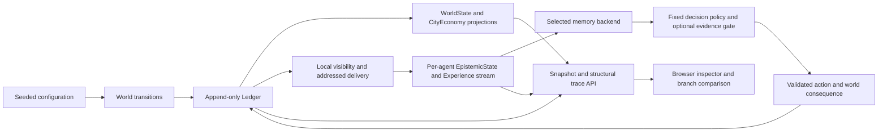

# Fork the City: implemented architecture

The city extends Kalends' existing event ledger and epistemic model. It runs
offline with deterministic Python rules and a static browser interface; no
language-model service supplies state, dialogue, or explanations. Experimental
outcomes are reported separately in `RESEARCH_NOTE.md` when generated.

## State and data flow



`kalends/events.py` remains the canonical `WorldEvent`/`Ledger` implementation.
`kalends/world.py` projects location and proposition changes; the city applies
explicit relationship updates to trust as well. `CityEconomy.apply()` projects
cash, inventory, market stock, posted prices, commitments, and relationships
from event effects. Policies cannot create facts by returning an answer.

`kalends/city/scenario.py` supplies a seeded supply schedule, initial accounts,
roles, and location schedules. Supply changes are exogenous; purchases change
stock and subsequent prices. Coordinates describe a schematic, not historical
geography. Roles currently share the same decision mechanism.

For each tick, `CitySimulation.step()` executes movement, world updates, due
inspections, the initial outdated-manifest report when applicable, due messages,
new gossip, decisions, and commitment settlement, in that order. Gossip is
queued for later delivery and has a configurable relay-depth limit. Contact
selection is capped per speaker for tractable population scaling.

## Information and decisions

Public observations require co-location; private observations require the
intended actor. Messages create an exposure for their addressed recipient.
`EpistemicState` retains the existing trust/freshness semantics: direct
observations are accepted, while hearsay requires sufficient trust and a newer
information vintage. Trusted equal-vintage repetitions are retained as
corroboration records without replacing a current belief. A false rumor can be
locally accepted while remaining false in the world.

Every policy receives only `decide(experiences, tick, agent_id)`. The callback
does not receive `WorldState`, `CityEconomy`, the simulator, or authoritative
supply. The engine validates action labels and requires cited evidence IDs to
belong to that agent's received stream. Evaluator fields such as actual supply
and loss are computed after the choice and removed from the public decision
event. The operator snapshot intentionally includes world truth and evaluator
diagnostics for inspection; it is not an agent input.

Decisions occur on scheduled ticks only when the agent's own inventory is below
its next delivery need. Thus earlier actions can change later opportunity
counts. The policy reserves on a disruption belief; otherwise it defers or
requests verification. Verification costs 1.5 and supplies a direct inspection
on the next tick when that tick exists. A terminal-tick inspection can incur
cost without producing evidence before the world ends.

The scoring rule charges 2 for reserving while supply is available, 6 for
deferring while disrupted, and 1.5 for verification, with zero otherwise.
“Decision regret” equals this categorical loss relative to the zero-loss
world-informed choice. It is **not financial profit regret**: purchases,
affordability, market scarcity, delivery penalties, and cash are computed
separately. These scores are conditional on the declared task and costs.

## Memory adapters and comparison limits

`kalends/actionbench/policy.py` reuses `StructuredMemory`, `BM25Memory`,
`VectorMemory`, `HybridMemory`, and `HybridGuardedMemory`. At each decision it
rebuilds the selected backend from the same FIFO suffix of that agent's
experiences. Capacity counts episodic records too; **0 means unlimited** in the
city contract. The audit ledger and full exposure history remain in memory even
when the tested backend receives a limited suffix.

Retrieval retains its original top-four rule. Structured storage uses exact
proposition keys within the retained budget; structured gating support is also
capped at four. This equalizes record retention, not representation or lookup
power. Proposition fields, trust judgments, vintage, and claimed roots are
supplied. Keyed structured queries are a schema-assisted track, and vector
retrieval uses hashed bag-of-words, not a modern semantic embedding model.

The `lineage` gate counts distinct supplied origin labels; `source_count` counts
immediate senders as an ablation. A selected direct grain observation bypasses
the count threshold. Roots mean declared ancestry, not proven statistical
independence. The simulator preserves honest labels through relays; it does not
authenticate provenance or test arbitrary source forgery. Gating uses only the
backend's selected support. Full received history supplies diagnostic QA labels,
not a second store consulted to authorize an action.

## Forks, comparisons, and causal claims

`fork()` deep-copies the current completed-tick state: ledger, economy,
experiences, epistemic states, policies, pending messages/inspections, and relay
bookkeeping. It leaves the original unchanged. Supported interventions are:

- `none`: an identity continuation with no state edit.
- `correction`: a named agent visits the grain yard and directly observes the
  actual current supply; the caller cannot substitute a false “verified” value.
- `remove_message`: cancel one queued, undelivered report.
- `replace_message`: change a queued report's value and create a new provenance
  root linked to the intervention.

The copied ledger is an identical prefix. Intervention events are appended at
the current tick; future progression uses the same rules. Random draws are
keyed by semantic context such as seed, tick, speaker, and listener, with no
mutable draw-consumption state. The city does not use the legacy simulator's
event-ID-keyed alias randomization.

Comparison computes differences in agents, beliefs, decisions, relationships,
pending messages, and world projections. For a time-matched outcome comparison,
advance both continuations to the same tick. Event IDs can shift after a fork;
decision comparison uses agent/tick keys and belief comparison omits evidence
IDs. `trace()` traverses recorded parent edges, including information,
price/stock, and action dependencies.

A chosen intervention and paired continuation can demonstrate its effect within
this coded model. A structural parent edge alone does **not** establish causal
necessity. There is no exhaustive “which event was necessary?” search, arbitrary
past-tick editing, or general causal identification API. Replacing a report with
the same text still creates an explicit new root; use `none` for an identity
control.

The optional `verify_message_dependency()` function in `kalends/city/causal.py`
goes beyond structural tracing for a bounded case: an original-timeline decision
with a queued-message ancestor and a reproducible default policy. It reconstructs
the factual completed-tick prefix, confirms identical history, deletes one pending
message, and advances both worlds to the decision. It returns changed, unchanged,
or unsupported results without mutating the displayed histories. This verifies
one deletion effect under the coded model; it neither finds a minimal cause set
nor establishes necessity across all possible interventions. The browser exposes
it as **Test a message dependency**, through `/api/necessity`.

## Clean Python example

Run from the repository root with Python 3.10 or newer:

```python
from kalends.city import CityConfig, CitySimulation

original = CitySimulation(CityConfig(seed=42, n_agents=8, n_ticks=24))
original.step(2)                     # ticks 0 and 1 are complete
prefix = original.ledger.to_json()
branch = original.fork({"kind": "correction", "agent": "Livia"})
assert branch.ledger.to_json()[:len(prefix)] == prefix
assert original.ledger.to_json() == prefix

original.run()
branch.run()
comparison = original.compare(branch)
snapshot = branch.snapshot()
decision = next(d for d in branch.decisions if d["agent"] == "Livia")
trace = branch.trace(decision["event_id"])
print(comparison["changed_actions"], snapshot["tick"])
print(trace["interpretation"])
```

For a queued-message intervention, obtain its current ID from
`original.messages` before advancing through delivery, then pass that ID to
`fork({"kind": "remove_message", "event_id": message_id})`. A custom policy can
be supplied through `CitySimulation(config, policy_factory=...)`; its factory
receives agent/config, and its `decide` method must obey the local-information
contract. This is a research API, not a general scenario SDK.

## Browser adapter and persistence

Start the loopback server from the repository root:

```bash
python3 -m kalends.city_server --port 8765
```

Open `http://127.0.0.1:8765`. The static HTML/CSS/JavaScript client reads actual
snapshots and requests steps; Run/Pause controls the frequency of those
requests. It renders a schematic map, timeline, agent/decision inspector,
structural traces, and original/branch differences. The server holds one
original and one visible branch; creating another fork replaces that branch.

`CitySession` serializes mutations with a lock. `GET /api/state`, `/api/trace`,
and `/api/export` expose state, ancestry, and a portable JSON record. `POST
/api/reset`, `/api/step`, and `/api/fork` are the mutation endpoints. Same-origin
checks constrain browser mutations. The service binds to loopback and is not a
multi-user or public hosting service.

The default `.kalends/city_session.json` stores a versioned configuration and
command journal through temporary-file replacement. Restart replays accepted
commands against the same implementation; this is not a version-independent
snapshot migration format. Reset replaces the session journal. Pass
`--journal ''` to disable persistence. Full browser snapshots and audit histories
grow with the run; production storage, incremental snapshots, and multi-session
management are future work.
