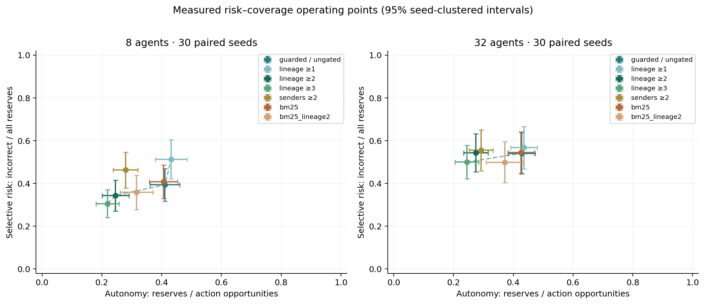

# Fork the City: local memory accuracy, verification, and consequential choice

**18 October 2026 · executable research note, not a publication claim**

## Question and implemented contribution

When a memory accurately retains an agent's received information, can that agent
still make costly choices? Does collapsing repeated reports to source lineages
improve decision regret beyond counting immediate senders, and at what autonomy
cost? How do those effects change under retention limits and population growth?

Kalends now connects its existing deterministic event/observation/memory substrate
to a live grain economy, local-evidence decisions, persistent accounts and
commitments, queued communication, exact continuation forks, and a browser
inspector. A bounded deletion test reconstructs a factual prefix and removes one
supporting message to test a selected decision. The contribution is an executable
integration and a reproducible, mixed empirical finding; none of event sourcing,
provenance, agent memory, counterfactual worlds, or action gating is invented here.

## Baseline and design

The pre-sprint repository at `8040b22` passed 40 tests; its seed 42 MemoryBench run
contained 1,034 events and 427 questions. Those are **historical baseline numbers**,
recorded separately in `results/fork_city/baseline/`. They are not ActionBench
results. The new study's engine/memory/evaluator source was frozen at `ce2f2b8`;
per-file hashes are saved with each experiment. Later changes add a browser
dependency-test endpoint/module and improve plot labels, without changing the
studied transitions, policy, costs, or evaluator.

World truth follows a context-keyed exogenous supply schedule. Agents observe
only co-located public events, addressed private events, and delivered reports.
A stale harbour manifest can conflict with actual supply; relays preserve its
root label. Movement, gossip delays, and contact selection use keyed randomness,
so event deletion does not shift an unrelated random stream. Decisions and
inspections can change locations, inventories, later eligibility and information.

At scheduled ticks, agents needing grain choose **reserve**, **defer**, or
**verify**. A fixed policy reserves on a retrieved disruption belief, otherwise
defers; a gate can request a paid inspection instead. Inspection evidence arrives
the next tick. Policies receive only local `Experience` records, tick and agent
ID. Authoritative supply is attached afterward for evaluation.

Four existing backends are compared: structured, BM25, naive hybrid, and guarded
hybrid. Gates count distinct roots or immediate senders; direct selected
observations bypass the count threshold. Main retention is FIFO 64 records per
agent, including episodes; retrieval and gating support are capped at 4. Structured
lookup still uses exact proposition fields, while BM25/vector use lexical
retrieval. Encoded trust/freshness judgments and schema are supplied. This is a
schema-assisted memory track, not a comparison of natural-language understanding
or modern embedding models. The structured QA ceiling is expected by design.

| Study | Seeds | Families | Agents | Conditions | Worlds |
|---|---|---|---|---:|---:|
| Development |0–9|4|8|11|440|
| Main held-out |1000–1029|4|8,32|11|2,640|
| Scaling held-out |same 30|4|128|5|600|
| Retention/depth sensitivity |same 30|4|8|5 × 4 settings|2,400|

The four families vary initial shortage, supply reversal, seeded rumour and
private official information. They share one market mechanism rather than
independently authored domains. Main conditions include no gate; guarded
lineage thresholds 1/2/3; threshold 2 sender count; BM25 plus lineage 2; and
always-defer/always-verify floors. Scaling retains the four ungated memories and
guarded lineage 2. Sensitivity varies capacity 8/unlimited and relay depth 1/6 from
the baseline 64/depth 3. Thresholds/costs were not selected against held-out results.

Final held-out studies record **5,640 worlds and 1,041,627 decisions**. They still
have only **30 paired seed clusters**, not a million independent samples. We
average family-world rates within seed, then report seed means and approximate
95% t intervals, using paired seed differences for contrasts. Intervals are not
adjusted for multiple comparisons; conclusions remain conditional and exploratory.

## Scoring

The declared task charges 2 for reserving while available, 6 for deferring while
disrupted, 1.5 for inspection, and 0 otherwise. “Regret” is this loss relative to
the zero-loss world-informed label. It is **not realized financial or delivery
regret**: physical fills, affordability, posted prices, delivery penalties and
balances are computed separately. A zero-fill attempted reservation can still
receive the reserve task label. This limits the welfare interpretation.

Action error counts incorrect reserve/defer choices; verification is charged in
regret rather than counted as a label error. Autonomy is reserves divided by
eligible opportunities; defer is abstention. Selective risk is incorrect reserves
divided by all reserves. False abstention counts useful shortage reservations
withheld. Zero reserve risk at zero coverage does not mean task success. Earlier
actions affect inventory eligibility, so policy opportunity counts can differ.
Local QA compares against the agent's received accepted belief, not world truth.

## Actual findings

### Correct local recall is insufficient

Structured and ungated guarded hybrid attain local QA 1.000 at 8, 32 and 128 agents,
yet action-error rates are **37.59%, 43.90%, 49.35%** respectively. Their mean
regrets are **1.6107 [1.4262, 1.7953]**, **1.8322 [1.6461, 2.0183]**, and
**2.0898 [1.8972, 2.2825]**. They can faithfully remember a false or obsolete report.
This demonstrates the distinction within this task, not a general result about
memory quality in deployed agents.

Guarding fixes measured hybrid boundary violations and improves local QA by
2.07 percentage points at 8 agents and 0.49 points at 32. Nevertheless, naive and
guarded hybrid have identical action sequences and task regret in all paired
main worlds; regret difference is exactly 0 [0, 0]. Here, many erroneous available
answers and correct unknown answers both map to defer. An epistemic improvement
need not alter this policy's downstream action.

### Lineage gating changes the operating point, without a clear lineage advantage

| Agents | Guarded condition | Reserve coverage | Risk among reserves | Mean regret |
|---:|---|---:|---:|---:|
|8|ungated|41.10%|39.35%|1.6107|
|8|sender count 2|27.92%|46.29%|1.8276|
|8|lineage 2|24.60%|34.39%|1.8155|
|32|ungated|42.77%|54.08%|1.8322|
|32|sender count 2|29.24%|55.49%|1.8540|
|32|lineage 2|27.46%|54.26%|1.8511|
|128|ungated|41.13%|59.40%|2.0898|
|128|lineage 2|28.33%|56.84%|1.8854|

Sender-count minus lineage regret is **+0.0121 [-0.0191, +0.0433]** at 8 and
**+0.0029 [-0.0082, +0.0140]** at 32. Neither supports a lineage-specific regret
gain. Compared with ungated guarded memory, lineage 2 **increases** regret by
0.2048 [0.0512, 0.3583] at 8, has an uncertain difference at 32, and **reduces** it
by 0.2045 [0.1023, 0.3067] at 128. Scaling lacks a sender-count ablation, so the
128 result concerns the combined verification policy, not isolated lineage value.

Always-defer has mean regret 2.8276 at 8 and misses every useful reserve. The always-verify policy costs 1.5 with zero autonomous reserves. Its low score illustrates the
declared cost model and must not be presented as autonomous economic success.

The plotted line joins nondominated predeclared guarded operating points. It is
an empirical threshold frontier, not a matched-coverage causal comparison or an
optimized universal frontier. Intervals and all conditions appear in the raw
summary and [measurement table](../../results/fork_city/heldout/TABLE.md).

### Retention limits reverse a familiar architecture comparison

At capacity 8, naive hybrid has **0.2863 less regret [0.1785, 0.3940]** than guarded
hybrid. A retained repeated claim may have `accepted=False` because an earlier
accepted instance was evicted; the guarded table loses its belief while retrieval
can still use a surviving report. Adding verification helps the guarded backend
here, but sender-count and lineage gates remain indistinguishable in regret:
sender-minus-lineage **-0.0024 [-0.0147, +0.0098]**. Capacity 64 is nonbinding for
these 8-agent worlds: unlimited retention reproduces all 600 corresponding ledgers
and decisions exactly. Depth 1 makes the two gates' action sequences identical;
depth 6 still yields no clear lineage-regret advantage.

### Corrections and actual causal inspection

After a valid contradictory direct observation, ungated guarded decisions recover
in mean **2.2208 ticks [1.9598, 2.4819]** at 8 agents among recovered cases, with
mean unrecovered fraction 3.40%. Lineage 2 gives 2.1994 ticks [1.9985, 2.4003] and
5.76% unrecovered. These are descriptive, scheduled-decision recovery measures;
censoring and endogenous inspection prevent a simple efficacy interpretation.

In the live seed 42 example, deleting Dama's queued message E5 from the completed
tick 1 prefix changes Livia's tick 2 reserve to defer. Factual replay first matches
the entire prefix and decision. A verified-inspection branch instead changes her
belief from disrupted to available and preserves twelve denarii at that tick.
The inspection intervention includes a physical visit; it is not a pure text-only
correction. Structural ancestry and a demonstrated single-deletion effect remain
distinct; neither establishes a minimal cause set over all histories.

### Posthoc physical outcomes expose a score/goal mismatch

An additional audit replayed all 1,320 eight-agent main worlds, matching their
complete decisions and ledger/semantic hashes, then checked cash, stock, inventory
and settlement conservation. These are the same worlds, not new independent
samples. Actual mean delivery fill was 65.87% for ungated guarded memory, 58.62%
for sender-count gating, 53.08% for lineage gating, and 16.30% for either floor.
Sender-count minus lineage delivered-fill difference was **+5.54 percentage
points [3.27, 7.82]**, and final cash was **+1.8469 denarii per agent
[0.8855, 2.8082]**. The less restrictive policy performed better on those physical
outcomes despite no clear categorical-regret contrast.

Always-verify and always-defer had identical deliveries and commitments, while
verification spent 10.9125 more denarii per agent [10.7071, 11.1179]. Its better
categorical score therefore does not indicate better economic performance.
Of 2,311 ungated-guarded purchase orders, 771 filled zero units; 694 zero-fill
disrupted reservations still received zero task loss. This posthoc diagnostic is
saved in `economy_audit.json`; it was not used to retune or replace the frozen
metric. The scoring model needs revision before making economic-reliability claims.

## Failure analysis, prior work, and limits

[Replayed failure cases](FAILURE_CASES.md) show a locally correct memory causing
loss6, an unauthorized retrieval accidentally producing a zero-loss action, and
the same-root gate both preventing a false reserve and withholding a useful one.
The field `source_independence_failure` is a correlated-support alert; direct-
observation bypasses mean it is not automatically a causal miscounting rate.

The closest prior work is CPB's lineage-collapse/admission tradeoff and
CivWorldBench's controlled multi-agent intervention rollouts. STATE-Bench and
MemoryArena already evaluate memory through downstream actions; LongMemEval-V2,
COUNTERMEM, FAME and provenance surveys cover other close components. See the
[primary-source audit](LITERATURE_AUDIT.md), including the distinction between
MemoryArena and the older notes' different MemArena. No first-of-kind claim is
supported by this sprint.

Validity is limited by one coded market, honest unauthenticated root labels,
supplied acceptance metadata, exact-key structured queries, lexical embeddings,
short horizons, and a categorical utility model. Full audit histories remain
unbounded despite capped tested memory. Fixed per-world stock arrivals and
locations mean population scaling changes competition and contact structure,
not merely computation. Branch deletion effects are internal to this simulator.
Concurrent suite runtimes should not be used as isolated scaling measurements;
the separate resource profile records sequential repeated runs and allocation
peaks. On this macOS arm64 host with CPython 3.12.14, five isolated seed-42 runs
had median simulation times of 0.0117/0.0864/0.5220 seconds at 8/32/128 agents;
separate peak Python allocation traces were 0.63/3.49/15.44 MiB. Process RSS
high-water marks were 27.64/40.08/83.44 MiB, including imports and retained
allocations. This is one-seed engineering profiling, not a population-level
performance result.

A physical audit of those same seed-42 worlds found zero grain filled in
53.7%/89.4%/96.7% of reservation attempts. Fully satisfied commitments fell from
20/24 to 22/96 to 47/384 as population grew while total arrivals stayed at 56
units per world. Many unfilled reservations still earned zero categorical task
loss. These actual outcomes are saved in `profile_economic_outcomes.json` and
make the score/goal alignment limitation material, not hypothetical.
Research-worthy general superiority is **not established**.

## Reproduction and next experiment

Run the commands in [RUNNING.md](RUNNING.md). Raw per-decision records, configs,
source hashes, seed-cluster statistics, semantic replay verification and generated
plots are under `results/fork_city/`. The original historical artifacts are intact.
Engineering pilots are marked and excluded from all reported final results.

The next test should prospectively define utility from executed fills,
commitment delivery, information age and inspection delay; scale supply per
capita as a separate factor; and compare sender/lineage/verification policies at
matched coverage. Use an independently authored scenario and new untouched seeds.
That would test whether lineage adds value beyond general verification rather
than assume it. The current deliverable is a useful research instrument and a
playable product prototype, with a negative/conditional scientific result.
