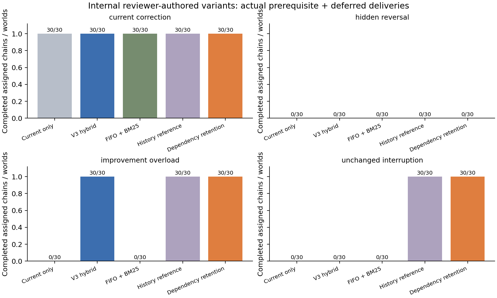
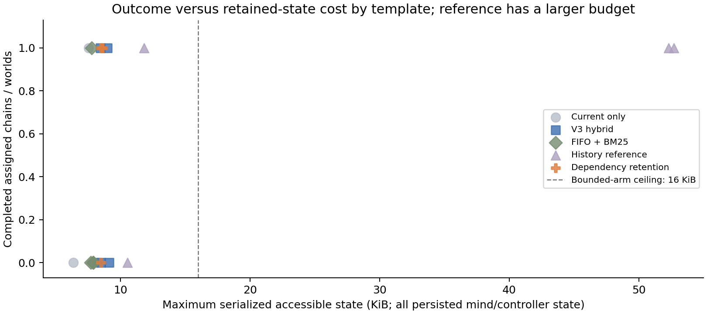

# Next-phase continuity diagnostic

This is an **offline, internally authored engineering study**, not an external benchmark, an independent replication, a live language-model evaluation, or evidence about human learning or subjective time. A small exact-dependency retention patch improved actual obligation-chain completion in one reviewer-authored variant and avoided paid rechecks in another. The remaining ties and information-limited failure are retained.

## What was executed

The [initial development gate](../../results/next_phase/research/development_gate/summary.json) ran 128 worlds before the candidate was implemented. Deleting the shipped V3 next-action plan left the old changed-goal decisions unchanged. The source confirms that V3 chooses before recording that next-action plan; adding another plan register would not repair that limitation.

The new evaluator therefore gives **every memory arm the same resumable phase controller** over the existing Commons domain. It obtains a legitimate report, accepts a fixed four-unit obligation, pauses, allocates and settles a prerequisite, resumes a deferred obligation, receives a correction when the case supplies one, pauses again, and allocates and settles the follow-up. Both projects must complete from actual delivered units. The prerequisite cannot be completed by the same settlement as its dependent project.

Four checkpoints serialize and reconstruct the actual world ledger, existing economy/state projections, EventClock, NPC minds, participant mind and controller. The controller reads its phase/round to resume. Current balances, enforceable promises and the public project register are available equally to every arm; an old promise is not artificially hidden to manufacture a memory task.

The [frozen comparison V2 protocol](../../results/next_phase/research/frozen_comparison_v2/protocol.json) specifies four development templates × eight seeds × five arms, plus four reviewer-authored internal variants × thirty fresh seeds × five arms: **760 worlds**. Receipt timing and salience vary with the exogenous seed. Zero-distractor controls are functional repeats; thirty seeds are not thirty independently authored tasks. The reviewer supplied the heldout variants before inspecting candidate code or results. They vary correction direction, observation availability, interruption length and current-report timing within one two-round Commons scaffold. This does not cover two independent domains, correlated testimony, false corrections, competing-goal repair, multi-month cognition or a general planner.

## Mechanism and accounting

Only after the development gate demonstrated a V3 deficit to legitimate retained history did the evaluator add a small `PersistentMind` subclass: its existing retention score receives a fixed 0.6 bonus for accepted records matching exact active-goal evidence keys. All arms receive those same keys and action contracts. The patch stores no extra cache and keeps existing V3 belief revision, retrieval and action selection. Removing the override is exactly the V3 hybrid baseline. There is no new belief-invalidation mechanism to ablate and no novelty claim.

Bounded arms share a ceiling of **16 KiB for the complete serialized participant mind plus controller**, sixteen retained records and four context records. This includes inherited goals, next-action plans, last decisions, summaries, phase state, ingress cursor and support/receipt identifiers. Evicted facts cannot be restored through a provenance identifier; admitted records are checked against actual received content and host ingress is monotonic. The canonical ledger and full world checkpoints remain evaluator storage.

The admissible-history reference has 256 records and the same four-record retrieval context, with its larger byte use disclosed. It is a headroom reference, not a matched deployable competitor. Actual footprints differ under shared ceilings. Tokenization, separate retrieval latency, transient index allocation peaks and process RSS were not measured; wall time includes controller and checkpoint work and is descriptive. The plots show persisted-state cost, not a complete hardware or inference frontier. **There were zero inference calls, embedding calls and paid API calls.** Dense retrieval and external frameworks remain unexecuted; lexical BM25 is the actual baseline.

## Primary and cost results

Each cell below is completed assigned chains out of thirty worlds. Inspection costs are real transfers from the participant's single credit; a second recheck is unaffordable. The resource constraint is part of this authored task, not an estimate of a real-world cost distribution.

| Internal reviewer variant | Current observation only | V3 hybrid | FIFO + BM25 | Admissible history | Dependency retention |
|---|---:|---:|---:|---:|---:|
| Current correction immediately before the decision | 30/30 | 30/30 | 30/30 | 30/30 | 30/30 |
| Hidden reversal without a received correction | 0/30 | 0/30 | 0/30 | 0/30 | 0/30 |
| Reverse correction followed by heavy interruption | 0/30 | 30/30 | 0/30 | 30/30 | 30/30 |
| Unchanged condition, long interruption, no fresh report | 0/30 | 0/30 | 0/30 | 30/30 | 30/30 |

In the reverse-correction variant, V3 and the patch tie on completion, while V3 pays thirty inspection credits and the patch pays zero. In the unchanged-condition variant, the patch wins thirty paired completions and V3 wins zero. This reviewer case retains the supplied label `memory_irrelevant`; its actual mechanism still requires history because the condition report is absent from the current observation. It is a continuity control without a revision, not proof that memory is irrelevant.

The frozen development comparison completes 8/8 corrected overloaded chains with the patch versus 4/8 with V3 in each of two templates. Their paired seed-bootstrap completion differences are 0.50, with conditional 95% intervals [0.125, 0.875]. Heldout per-template intervals are [1, 1] for the unchanged-condition difference and [0, 0] for the three ties. These intervals are conditional on a small authored scaffold. Zero-width intervals do not establish general certainty or equivalence. The older initial gate used fixed salience; the final generator's seeded receipt timing/salience variation was frozen before the heldout execution.

Maximum persisted state in the heldout run is below 9 KiB for the patch, below 9.4 KiB for V3, and approximately 52.7 KiB for the generous reference. No bounded arm exceeds its 16 KiB ceiling. No unauthorized evidence use or invalid executed action was recorded. Stale actions after an actually received correction were absent. Source-independence accuracy and post-failure repair were not tested.





## Controls, failures and audit limits

The retained [controlled probes](../../results/next_phase/research/frozen_comparison_v2/arithmetic_controls.json) remove relevant reports, insert unrelated receipts, change earlier legitimate condition evidence under identical current institutional inputs/action contracts, erase the inherited next-action plans, provide a literal public current observation and change an earlier enforceable commitment. Relevant-record removal changes actual completion; unrelated receipts leave the generous reference's decisions unchanged. A changed public commitment is detected from the institutional register rather than from episodic memory. Every arm completes the separate one-round public-observation control. Unsupported IDs, altered content and another actor's episode are rejected by adapter tests.

The patch still fails the hidden reversal: its remembered stable report was legitimately received, while the hardware later changed privately. The common controller does not schedule a precautionary second-round inspection when it already has apparently supported evidence. That is an information/policy limitation, not evidence that it should have remembered unobserved truth. In contrast, V3's failure after an unchanged-condition interruption follows eviction of relevant admitted evidence and consumption of the one available recheck. The reverse-correction tie shows that existing revision can preserve useful corrected support; a completion-only aggregate would hide the recheck cost.

A reviewer found a mutable-plan alias in the first 760-world audit trace. Its source archive and raw worlds remain in [the preserved first run](../../results/next_phase/research/frozen_comparison/SUPERSEDED_TRACE_NOTE.md). V2 detaches that snapshot and reruns the identical cases, seeds, candidate and endpoints; it is an audit repair, not retuning. Use V2 for before-choice plan provenance. All 760 world ledgers, choices and outcomes match the first execution; all 1,840 corrected before-choice traces have the expected pending phase. V2 preserves 39 unchanged source files and has zero operational failures. Independent receipt arithmetic passes all 760 raw worlds, eight selected cases replay exactly from the actual frozen source archive, and twelve research tests pass. These are reproduction checks, not independent scientific implementations.

The result supports a narrow engineering claim: precise, explicitly supplied dependency relevance can improve this existing bounded retention heuristic under this authored operational-noise distribution. It does not establish a novel memory architecture, learned plan resumption, superiority on realistic task distributions, or a reason to replace all existing cognition defaults. Further development requires independently authored task structures, real competing planners and provisioned modern retrieval; generality and live-model claims remain gated on those experiments.

## Reproduction

```sh
python3 -m pytest tests/test_next_phase_research.py -q
python3 -m kalends.next_phase.diagnostic --out /tmp/kalends-continuity-reproduction --dev-seeds 8 --test-seeds 30 --gate results/next_phase/research/development_gate/summary.json
PYTHONPATH=. python3 scripts/check_next_phase_research.py --results /tmp/kalends-continuity-reproduction
MPLCONFIGDIR=/tmp/kalends-mpl python3 scripts/plot_next_phase_research.py --summary /tmp/kalends-continuity-reproduction/summary.json --out /tmp/kalends-continuity-reproduction/figures
```

The runner refuses to overwrite an existing output directory. `frozen_source.zip`, protocol/source hashes, compressed raw worlds, checkpoints, admitted streams, actual receipts, per-template summaries, figures, arithmetic controls and frozen-source replay results are retained beside the V2 summary.

## Prepared human-use protocol — not executed

This is preparation for a small formative usability study with consenting adults; **no participant has been recruited, contacted or enrolled and no human results are claimed**. Obtain appropriate institutional/partner review before any formal human research. This protocol concerns comprehension and voluntary use; the separate delayed-transfer learning proposal in the existing thesis remains unexecuted.

Before any session, freeze the build/source hash, content, starting saves, prompts, event schema, idle threshold, scoring rubric and exclusions. A material repair creates a new labeled cohort; do not pool builds silently. Use fresh study copies in both Pompeii and Shared Observatory, counterbalancing domain order. In each, ask the participant to identify their situation and a person, make an ordinary interaction and a consequential choice, inspect the recorded consequence, then close and later resume that same life. Record confusion and assistance. The saved world is paused while closed: explain a return through actual saved/advanced history rather than implying off-screen progression.

Consent must be optional, specific and revocable without losing access to the product or the participant's save. Local action/usage logging and an application-window screen recording require separate opt-ins; declining recording must not exclude ordinary use. Keep telemetry off by default. Proposed records are a build hash, random study/session IDs, pseudonymous life ID, relative timestamps, focus/visibility/pause events, validated action categories, bounded numeric arguments, receipt IDs and outcome codes. Do not log raw speech, microphone audio, free-text conversations, unsent drafts or keystrokes. If screen recording is separately accepted, capture only the study application, mask personal inputs and pause capture around free text or unrelated content; moderator notes should paraphrase observations. These are collection rules, not a claim that every instrument is already implemented.

Freeze the following operational definitions before observing anyone:

| Measure | Definition |
|---|---|
| First meaningful action | First persisted, participant-visible validated action that changes an actual resource, obligation, relationship or consequential state. Navigation, camera movement and opening panels do not qualify. Report wall time and active time from the first usable world view separately. |
| Return consequence understood | On resuming the same life, the participant identifies a particular person or obligation, a supported changed outcome and the earlier action linked to it. Score from participant-visible receipts/history with a fixed rubric; log assistance and unsupported claims separately. A statement that something changed is insufficient. |
| Active time | Foreground, visible application intervals with input within the preceding sixty seconds; stop on blur, hidden view or explicit pause. Report the threshold, idle time and total wall time. This is a usage heuristic, separate from simulated calendar time and perceived duration. |
| Behavioral return/retention | Among consented, eligible first-session participants, same-life reopening plus a validated action during days 1–7 after the first session. Mark a scheduled observer follow-up, requested return or reminder separately; none counts as unprompted retention. Report numerator, denominator, missing observation and withdrawal, without interpreting a small formative count as a population retention estimate. |

Any LAB/operator exposure or known prior access to hidden canonical information marks that participant/life as operator-exposed. Exclude it from naive comprehension and ordinary-return analyses using this prespecified rule, retain its usability defects in a separate labeled account, and never remove it merely because its outcome is unfavorable. Report both domains separately; do not infer enjoyment or learning from a successful task.

A separate consenting facilitator task can ask someone to express one supported Observatory constraint, predict who can observe its report and the resulting feasible allocation, then inspect the existing validator and receipts. Interview for authoring clarity, correction effort and facilitation usefulness. This is a narrow finite-schema task; an unimplemented Studio form is not a usable authoring product, and interest expressed in an interview is not purchase evidence.

Keep consent/contact linkage separate from local pseudonymous observations, restrict access to the named study team, and share only explicitly approved redacted extracts. Proposed retention is thirty days for identifiable recordings and linkage, ninety days for pseudonymous event rows, then deletion; only approved anonymous aggregates remain. State these periods and the withdrawal cutoff in the consent. Withdrawal stops new collection immediately and deletes linkable study records before anonymization; offer deletion of study-life copies separately from the participant's personal save. Explain that truly anonymous aggregates cannot later be linked back for removal. Record consent changes locally. Do not enable collection, recruit participants, send invitations or claim outcomes as part of this coding phase.

## Primary-source comparison checked for this execution

The following supplied versions were opened on 24 October 2026. These are literature checks, **not systems implemented or baselines reproduced here**. Their scores and model budgets are not comparable to the deterministic Commons results.

| Primary source and inspected section | Narrow verified comparison and boundary |
|---|---|
| [MemoryArena, v2](https://arxiv.org/html/2602.16313v2), abstract and evaluation design | Couples earlier experience to later action in interdependent sessions across several agent environments. Kalends' task-dependence gate follows an established evaluation direction; the small Commons scaffold supplies no claim of equivalent breadth or new memory-to-action evaluation. |
| [AMA-Bench, v4](https://arxiv.org/html/2602.22769v4), §6.3 and Appendix H | Its main protocol uses QA over agent trajectories, and this version also evaluates downstream TextWorld and Spider2 execution with a common execution agent while varying memory. Describing it as recall-only would be incorrect. Kalends does not implement its causality graph or compare against AMA-Agent. |
| [Mem2ActBench, v1](https://arxiv.org/html/2601.19935v1), abstract and §§5.3–5.4 | Separates tool selection from grounding historical constraints into correct arguments. This supports distinguishing action choice from valid quantities/recipients and actual receipts. Kalends' typed fixed options do not reproduce its implicit tool-argument reconstruction problem. |
| [Hindsight, v1](https://arxiv.org/html/2512.12818v1), §§3.1–3.2 | Separates world facts, experiences, opinions and synthesized observations, with retain/recall/reflect operations and multiple retrieval strategies. Evidence/belief separation is established prior work. The current patch is a bounded score adjustment, not a reproduction of Hindsight's architecture or reported conversational benchmark results. |
| [Can Agent Memory Systems Track Evolving State? / StateMemBench, v1](https://arxiv.org/html/2608.19652v1), abstract and §§3–5; preprint | Explicitly distinguishes currently operative state from superseded state and proposes tracking supersession/dependencies. This is close prior work for revision claims. Kalends retains its existing revision mechanism and measures actual settled actions; it has neither implemented StateMem nor established a novel general state-tracking method. |

The practical implication is to keep the current finding about this retention heuristic and authored noise distribution, preserve the negative cases, and compare actual external implementations only after provisioning and budgeting them. No additional cognition run, live-model call or scientific superiority claim follows from this source check.
