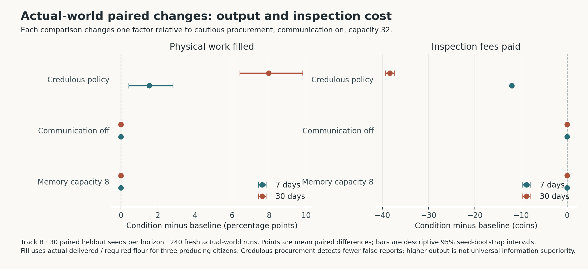
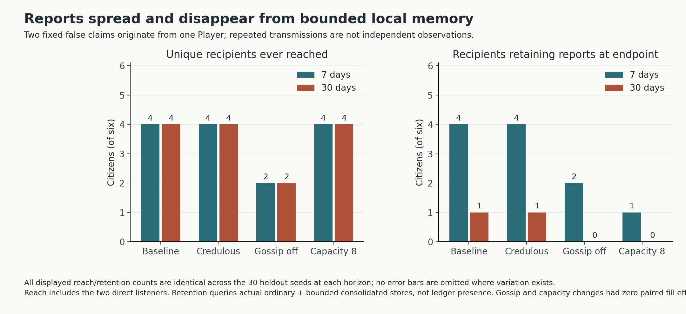

# Track B — Information, memory and obligations in the playable district

This study runs the actual `PompeiiWorld`, not a substitute information task. It asks whether three isolated changes alter executed production, costs, communication, retained records and relationships during a player's absence. It does not assume that more information, more memory or caution improves every outcome.

## Protocol fixed before heldout execution

The baseline uses cautious procurement, scheduled NPC communication enabled and ordinary memory capacity 32. Three comparisons change one factor each: credulous procurement, communication disabled, or capacity 8. All other settings remain fixed, including six citizens, the additional bounded eight-record consolidation buffer, initial resources, dispatch mechanism and the 60-day configuration cap. Communication disabled suppresses scheduled NPC gossip; it does not remove the player's two fixed utterances.

Development seeds are **31000–31009**. Heldout seeds are **71000–71029**. Each seed has eight fresh worlds: four conditions at each of two horizons, **7 and 30 elapsed days after the prefix ends**. The horizons are separate runs, not extra independent replications. Conditions use the same seed and the same legitimate actions:

1. Walk to the bread counter and accept Felix's four-unit delivery promise.
2. Tell Felix that flour supply is disrupted.
3. Walk to Marcus at street coordinate (930, 415) and repeat that claim.
4. Walk to the household and accept Lucius's eight-coin advance and service obligation.
5. Take no further player action: no delivery, service, purchases or corrective reports.

The runner checks that actual supply is available at both utterances. These evaluator checks never provide NPC observations or modify the world. All prefix movements and interactions call the proximity-validated game methods. In the current model the prefix ends at minute 16, with claims at minutes 4 and 7. Its receipts and ledger hash must match across conditions within each seed and horizon; a mismatch aborts the run. Explicit compressed advances stop at elapsed days 1, 7 and, where applicable, 30 to measure retained records. This partition is identical across conditions. The endpoint is precisely prefix minute plus horizon × 1440.

The fixed absence intentionally leaves two obligations unmet. It is a stress case for the world's information and institutional mechanisms, not an optimized player strategy or a sample of ordinary human play. The two claims originate from **one player**, despite distinct utterance IDs. They are not independent confirmations.

`society_preregistration.json` records this design, metric definitions, seeds, bootstrap procedure and SHA-256 hashes of every Python file under `kalends/`. Registration requires explicit model-owner freeze confirmation. Heldout execution refuses missing registration, changed source/protocol or an existing output directory. Its manifest links the registration hash. Every run checks the source fingerprint again at completion. The manifest's Git commit is contextual; per-file hashes identify the actual working-tree sources.

## Outcomes and accounting

Three primary descriptive outcomes were declared: physical delivery fill rate, unique NPC recipients of actual player-origin reports, and unique recipients still retaining such reports at the endpoint. All declared measures are retained in the raw CSV and summary, including negative and zero differences.

Physical fill is the sum of actual `daily_work`/`bread_ready` flour delivered divided by required flour. Felix, Sabina and Lucius have modeled daily production requirements; the district has six citizens, but Chreste, Dama and Marcus have no recurring flour-output requirement. Delivered, required and missing quantities are reported separately. Player contract delivery is a separate measure, never counted as district production. Purchase attempts and filled units are also retained.

Cash is measured both from initialization and from the end of the prefix, separating the fixed household transfer from later changes. Inspection fees come from actual booking events, with NPC fees distinguished from total fees. Decisions are actual recorded buy/inspect/defer/wait choices, rather than language-model intentions.

Communication measures count real report events and unique recipients, separately recording direct speech, NPC relays, accepted relays and all accepted reports. Player-origin reach follows either fixed root event and the claimed observer Player. Rejected reports count as transmissions but not accepted relays. Reach including the fixed direct recipients is explicitly distinguished from additional propagation.

Retention reads only each citizen's actual ordinary and consolidated stores. It records exact direct-claim IDs, retained player-origin report IDs, current local knowledge, ordinary buffer size and consolidated buffer size at every checkpoint. An event's presence in the evaluator ledger does not count as remembered. Durable institutional cash, trust and commitments remain separate from factual memory.

False-claim assessments count actual relationship events whose recorded parents include a fixed direct claim. Contradicted, confirmed/truthful-but-outdated and historically unverified outcomes are separated. A later supply change alone does not prove an earlier lie. The newer Marcus claim can travel through Dama and supersede Felix's earlier claim; the runner reports what the actual inspection and retained-report logic does, without assigning an expected trust penalty. Final directed trust and each player's fulfilled, missed and open commitments are retained separately, including social penalties for absence.

## Analysis and reproduction

The unit of uncertainty is the seed. For each horizon and each nonbaseline condition, analysis reports the mean of within-seed condition-minus-baseline differences. Descriptive 95% percentile intervals use 4,000 bootstrap samples of the ordered paired seeds with `random.Random(72831)` and sorted indices 99 and 3899. Citizen, event and decision counts do not inflate sample size. These are descriptive intervals across many outcomes; no multiplicity-adjusted confirmatory significance claim is made.

Run from the repository root with Python 3.10 or newer:

```sh
python3 -m kalends.pompeii.society_bench --phase development --out results/pompeii/society_development_v1
# Only after the model owner explicitly freezes all Python sources:
python3 -m kalends.pompeii.society_bench --register --freeze-confirmed
python3 -m kalends.pompeii.society_bench --phase heldout --out results/pompeii/society_heldout
python3 -m pytest tests/test_pompeii_society.py -q
```

Each output directory contains `worlds.jsonl` (all cell metrics, prefix receipts, per-citizen outcomes, retained evidence, report events and assessments), `metrics.csv` (one row per world), `summary.json` (condition summaries and paired contrasts) and `manifest.json` (configuration, environment and source hashes). Artifacts are never silently overwritten.

## Development observations

The initial development run contains 80 worlds and reports unchanged source hashes during execution. Its mean physical fill was 0.979 under caution versus 1.000 under credulous procurement at seven days, and 0.566 versus 0.626 at thirty days. Caution incurred mean inspection costs of 12.0 and 37.5 coins across the district, while credulous procurement incurred none. Caution recorded one direct false-claim contradiction per world; credulous procurement recorded none. These are development observations, not heldout estimates.

Scheduled communication increased player-origin reach from two direct recipients to four total recipients in this script. Removing it did not change development physical fill. Capacity 8 reduced endpoint report retention, but did not change physical fill relative to capacity 32. These null physical effects are substantive limits of this scene's mechanisms, not grounds to hide outcomes or claim that communication and memory never matter.

## Heldout results

The frozen-source run completed **240 worlds**, covering all 30 heldout seeds, four conditions and two horizons. The end-of-run source check passed. The preregistered Python working-tree fingerprint corresponds to freeze commit `a024da5768f2eb1deaae3b89c586a56a574e3adb`; the manifests preserve individual file hashes. `wall_seconds` is an operational duration from a nonisolated run, not a performance measurement.

| Condition | 7-day physical fill | 30-day physical fill | 7-day inspection fees | 30-day inspection fees |
|---|---:|---:|---:|---:|
| Cautious baseline | 97.831% | 58.296% | 11.967 | 38.400 |
| Credulous only | 99.365% | 66.284% | 0.000 | 0.000 |
| Communication off only | 97.831% | 58.296% | 11.967 | 38.400 |
| Capacity 8 only | 97.831% | 58.296% | 11.967 | 38.400 |

Fill denominators are 63 units per world at seven days and 270 at thirty days. At thirty days baseline output averaged 157.400 units versus 178.967 under credulous procurement. All conditions had 28 procurement decisions at seven days and 120 at thirty days. Production degradation over time is an outcome of the authored cash, costs, consumption and supply system, not evidence of a historical rate.

The paired **credulous-minus-baseline** fill difference was **+1.534 percentage points [0.423, 2.804]** at seven days and **+7.988 points [6.420, 9.827]** at thirty days. Mean inspection-fee differences were **−11.967 coins [−12.000, −11.900]** and **−38.400 [−39.400, −37.467]**. Aggregate citizen cash change from initialization was −30.083 versus −17.650 coins at seven days and −212.017 versus −163.883 at thirty days; paired differences were +12.433 [11.933, 13.050] and +48.133 [43.950, 53.183]. These intervals describe paired seed means, not variability among citizens.

Caution detected one contradicted direct false claim per world at both horizons; credulous procurement detected none. Final Felix-to-player trust was 0.100 under caution and 0.380 under credulous procurement, while Lucius-to-player trust was 0.400 in every condition. All worlds missed both player commitments, delivered zero player-contract flour and retained the same eight-coin initial player cash gain. The additional Felix penalty under caution therefore reflects an actual report assessment on top of the missed promise. Better error detection coexisted here with lower production and higher costs; it is not a universal utility improvement.

| Condition | Unique player-origin recipients | Retaining origin reports at day 7 | Retaining origin reports at day 30 |
|---|---:|---:|---:|
| Cautious baseline | 4 | 4 | 1 |
| Credulous only | 4 | 4 | 1 |
| Communication off only | 2 | 2 | 0 |
| Capacity 8 only | 4 | 1 | 0 |

These counts were identical across all heldout seeds. With communication enabled, five actual player-origin NPC relay events occurred per world, reaching two additional citizens beyond the two direct listeners; disabling communication removed all five. Reports are not necessarily accepted, and multiple transmissions do not constitute multiple independent observers. Turning communication off changed reach by −2 [−2, −2] and endpoint retention by −2 [−2, −2] at seven days and −1 [−1, −1] at thirty days. Reducing ordinary capacity to 8 changed endpoint retention by −3 [−3, −3] and −1 [−1, −1]. Neither change altered physical fill, cash or inspection fees in **any of the 30 paired seeds**: those paired differences and their intervals were exactly zero. Thus this scene demonstrates propagation and forgetting, but fails to demonstrate a production benefit from either more communication or more factual memory.

The retained endpoint count is not a general memory score: it concerns this fixed pair of false reports and the current routine schedule. Consolidation preserves selected consequential relationship records separately. Full per-citizen stores, evidence IDs, report events, assessments and commitment outcomes are in the raw records, allowing these aggregate claims to be checked without treating the evaluator archive as an operational memory.

Saved artifacts: [preregistration](../../results/pompeii/society_preregistration.json), [heldout manifest](../../results/pompeii/society_heldout/manifest.json), [CSV](../../results/pompeii/society_heldout/metrics.csv), [world records](../../results/pompeii/society_heldout/worlds.jsonl), and [summary with all paired intervals](../../results/pompeii/society_heldout/summary.json).





Both figures also have SVG exports. The [plot manifest](../../results/pompeii/society_heldout/plot_manifest.json) hashes the saved measurements, figures and exact [plot recipe](../../results/pompeii/society_heldout/plot_recipe.txt). Plotting copies intervals and means from the saved summary; it performs no additional simulation, bootstrap or performance measurement. The recipe's command is documented in its first lines and refuses to overwrite existing figures. Both rendered PNGs were visually checked for readable labels and captions.

The world is small and its policies, obligations, supply process and conversations are authored. Seeds vary dispatches and routine timing within this fixed cast; they do not sample people or historical societies. Supply labels, cash and production need not move together. Any conclusion applies to this specified model and prefix. The experiment offers a reproducible mechanism check, not evidence of universal information superiority or a validated historical behavioral model.
