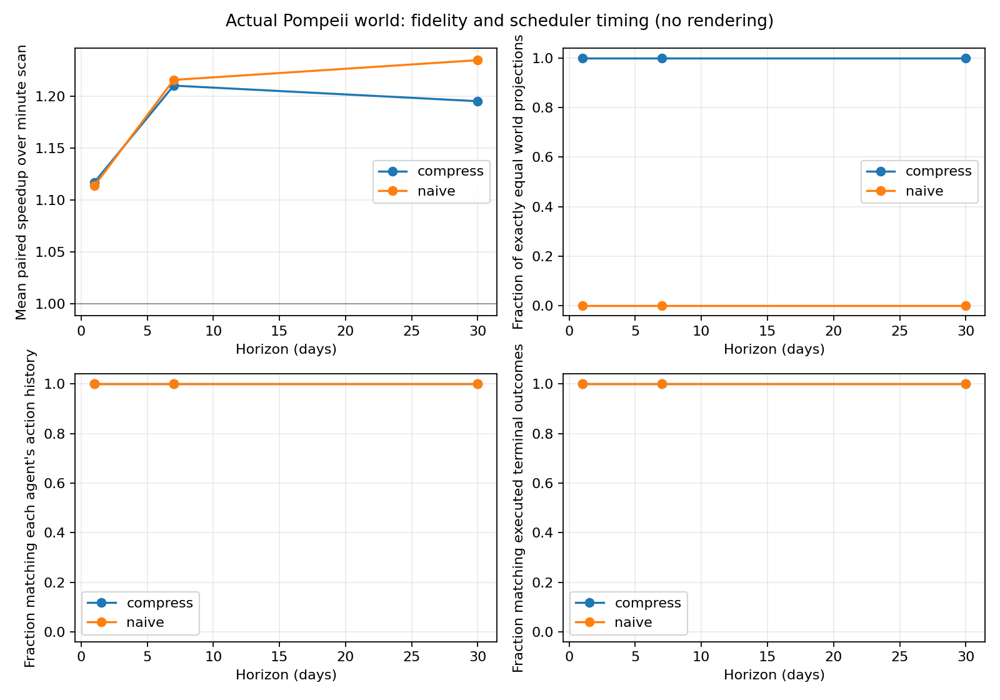

# Exact scheduled time and costly verification in a playable micro-society

**Kalends — Pompeii, 21 October 2026. Research draft; simulation case study,
not peer reviewed and not a human-user study.**

## Abstract

We integrate a navigable historical-fiction district with an authoritative event
ledger, scoped memory, resource settlement and a reusable time scheduler. A
frozen-source temporal evaluation runs 1,620 fresh worlds across thirty heldout
seeds, three horizons and three execution modes. Exact event dispatch matches the
minute reference in all ninety matched comparisons across ten declared
projections. Mean paired speedups are 1.117×, 1.210× and 1.195× at one, seven and
thirty days. A sixty-minute coarse baseline changes dated records and some
predictions but does not change action histories or terminal economic, trust or
commitment outcomes in this experiment. A separate 240-world matched society
study finds that costly cautious verification detects false claims while reducing
physical output relative to a credulous policy. Communication and memory changes
alter propagation and retention but have exactly zero physical-output effects in
the tested script. These results support a bounded engineering implementation
and reproduce a cost-of-verification tradeoff. They do not establish a novel
discrete-event algorithm, superior general agents, historical behavioral realism,
or an enjoyable commercial game.

## 1. Question and inherited evidence

Can a persistent world advance ordinary time with less computation while
preserving its consequential supported transitions? Separately, how do information
policies, communication and bounded retention affect actual outcomes rather than
only recall scores? The prototype joins these questions to a player who can move,
work, transact, make a promise, leave and return.

Genesis is preserved at `d37e8e7`. Its 900-world heldout study found a small
**adverse** lineage-gating effect on executed delivery: −0.18031 percentage
points, paired 95% interval [−0.25745, −0.10381]. Structured and guarded ungated
memory produced identical histories in all 180 matched pairs. Resource controls
were much larger than that gate effect. Those findings remain intact; Pompeii's
new conditions, seed ranges, economic rules and horizons are not pooled with them.
See [the Genesis paper](../genesis/RESEARCH_PAPER.md).

## 2. Prior art and the limited contribution

Discrete-event simulation, stable event queues, lookahead and lazy approaches
long predate this project. Fujimoto's
[parallel discrete-event simulation review](https://eecs.ceas.uc.edu/~wilseypa/classes/ece975/sp2010/papers/fujimoto-90.pdf)
and [SimPy's event scheduling documentation](https://simpy.readthedocs.io/en/latest/topical_guides/time_and_scheduling.html)
rule out an invention claim for jumping between event times. Multiresolution
simulation and temporally extended actions also have substantial prior art.

[Generative Agents](https://arxiv.org/abs/2304.03442) already combines memory,
planning, reflection and social diffusion. AgentSociety and later platforms,
engine-based simulation games, and narrative tools further narrow the space.
The [dated novelty audit](NOVELTY_AUDIT.md) records mechanism-level comparisons,
source limits and what would falsify a distinctiveness claim. Information cascades,
verification costs and the difference between epistemic correctness and useful
execution are established questions, not findings invented here.

The practical contribution is a small inspectable integration: playable spatial
permissions, dated information, bounded recall versus permanent institutions,
actual resource settlement, paired execution modes and reproducible outcome
audits. A schedule-supported exactness contract is useful engineering, but the
current experiment does not prove a scientific novelty claim.

## 3. Model and information boundaries

Authoritative state includes locations, positions, cash, flour, market stock,
price, supply state, trust and institutional commitments. Validated events update
reused Kalends ledger, state and economy primitives. Six fictional citizens use
keyed deterministic supply/routine draws, personal inventories, different caution
thresholds and explicit daily duties. Three have modeled daily flour-output
requirements. The game economy is open: production revenue and shortage penalties
are external flows. It is not a calibrated reconstruction of ancient prices or
welfare.

Each agent has a FIFO ordinary store, normally 32 records, and a separate bounded
eight-record literal consolidation store for selected consequential experiences.
The whole world is not bounded to forty records: the audit ledger and institutional
state continue growing. Operational knowledge reads retained accepted supply
records; the evaluator archive is unavailable to ordinary retrieval. Reports carry
observation dates, claimed origin event and observer. Confidence deduplicates the
origin observer, so repeated statements from one observer do not create independent
witnesses. Origin metadata is declared provenance, not cryptographic authentication
or a statistical independence guarantee.

Inspection costs one synthetic coin and arrives fifteen world minutes later. It
observes current supply and can acquire a dated dispatch record within a bounded
lookback to assess a retained player claim. This is an explicit paid institutional
observation. Current disagreement alone does not prove a lie. Procurement can
buy, inspect, wait or defer once, according to locally retained information and
accounts. A sufficiently trusted disruption report affects actual planning.

The player can finance a four-flour promise through work, household backing or
information brokerage. A household advance creates a real service commitment.
Settlements transfer actual resources, consume elapsed time and affect trust.
A delivery deadline does not teleport flour from a distant player. These policies
and opportunities are authored; seeds sample this model's draws, not human people.
The [historical ledger](HISTORICAL_SOURCE_LEDGER.md) labels the setting, attested
building anchors, reconstructed geometry and fictional lives separately.

## 4. Track A: registered temporal fidelity

The implementation and both study runners were frozen at
`a024da5768f2eb1deaae3b89c586a56a574e3adb` before heldout execution. Both
registrations capture the same complete 57-file Python fingerprint,
`3e99eb91af66bf6fcb61ea57d7ce714ba008807c12ad464910677f1c20d22dbd`.
No Python source changed during either heldout run.

Development seeds are 30000–30009; heldout seeds are **70000–70029**. Each
seed has fresh one-, seven- and thirty-day worlds under minute scanning, exact
compression and naive sixty-minute coarse dispatch. Each executes the same
legitimate prefix: walk to the bakery and accept an actual delivery promise,
then leave it unfulfilled. Five untraced fresh repetitions per cell produce a
median runtime; a sixth independent fresh repetition measures Python traced
allocation peak. This gives 270 cells, **1,350 timing worlds and 270 traced
worlds**. Timing includes construction and prefix, excluding one-time import.
Mode order is independently shuffled. Every repeat must reproduce its projection
hashes. Allocation tracing is never used as the speed timing.

The shared handler executes the actual game's autonomous transitions. The
computation-only comparison calls `clock.advance`, excluding the UI wrapper's
`time_advanced` record, whose payload names the selected presentation mode. It
compares full scheduled events, state including pending tasks and memory buffers,
dated beliefs, decisions, relationships and commitments. Additional projections
separate action-only history, action-plus-prediction history, terminal belief
values and terminal executed outcomes from timestamp/provenance differences.
No event or memory normalization hides a scheduled model difference.

Exactness follows for deterministic scheduled transitions: both exact modes
process the same earliest queued event, stable same-time order, state and newly
scheduled work. Empty minutes do nothing in the reference. Continuous processes,
external input during an advance and unregistered per-minute side effects are
outside this contract. The reference contains no artificial expensive work to
inflate speedups. It is already a strong inexpensive minute scanner, not a
full LLM policy invocation at every empty minute.

Within each horizon, descriptive 95% percentile bootstrap intervals resample the
thirty paired seeds. Repetitions, citizens, decisions and events do not increase
the independent sample size. Development pilots, including a source-guard-rejected
pilot, are retained and labeled; the final registered run uses the frozen model.
The [architecture report](LIVED_TIME_ARCHITECTURE.md) specifies projection and
scheduler semantics in full.

### Temporal results

| Horizon | Mean compressed runtime | Mean paired speedup | Descriptive 95% interval | Exact pairs |
|---|---:|---:|---:|---:|
| 1 day | 0.407 ms | 1.1168× | [1.0911, 1.1405] | 30/30 |
| 7 days | 2.025 ms | 1.2101× | [1.1952, 1.2267] | 30/30 |
| 30 days | 8.728 ms | 1.1950× | [1.1848, 1.2062] | 30/30 |

All ten declared projections match for compression in **90/90 comparisons**.
All 1,350 timing and 270 traced repeats are deterministic. At thirty days the
mean minute visits fall from 43,197 to 527; the actual scheduled event work still
has to execute, explaining why speed gains are much smaller than the check-count
ratio. Traced allocation peaks remain approximately 621 KB in both exact modes;
no substantial memory reduction is supported. These timings are tiny local CPU
measurements, not browser frame rates, hosted throughput or cost savings at scale.
The timed batch completed in 29.100 seconds; machine activity and scheduling noise
limit generalization even with paired medians.

The coarse baseline matches the full dated-record criterion in **0/90** cells.
That is not evidence of changed economic success. Action-only histories,
terminal belief values, executed outcomes, relationships and commitments match
in **90/90** cells. Action-plus-prediction histories differ in 16/30 seeds at
seven days and 16/30 at thirty days; these are predicted-value changes without
action changes. The declared coarse delay changes timing and provenance and
some intermediate information, but this experiment fails to show consequential
terminal distortion. Robustness to other schedules and player policies remains
untested.

## 5. Track B: matched epistemic society study

A separate preregistered design uses development seeds 31000–31009 and fresh
heldout seeds **71000–71029**. Four conditions change one factor at a time:
cautious baseline with communication and capacity 32; credulous policy only;
communication disabled only; capacity 8 only. The additional eight-record
consolidation capacity is held fixed. Thirty seeds × four conditions × two
elapsed horizons gives **240 worlds**. The fixed prefix accepts the flour
promise, asserts false disruption reports to Felix and Marcus while actual
supply is available, then accepts household backing and leaves. Its receipts
must match across conditions. It is a deliberate stress script, not optimized
or naturally sampled play.

Primary descriptive outcomes are actual daily flour delivery fill, unique
recipients of the player-origin reports, and recipients retaining them. Inspection
fees, accounts, actual decisions, individual results, retained evidence,
relationships and commitments are retained in raw artifacts. Fill denominators
are fixed daily requirements, distinct from the player's four-unit contract.
One-factor paired condition-minus-baseline estimates use thirty seeds and 4,000
bootstrap draws per horizon. Intervals are descriptive without multiplicity
correction. [The full study](EPISTEMIC_STUDY.md) defines every metric and limitation.

### Society results

| Condition | 7-day physical fill | 30-day physical fill | Inspection coins at 7 / 30 days |
|---|---:|---:|---:|
| Cautious baseline | 97.831% | 58.296% | 11.967 / 38.400 |
| Credulous only | 99.365% | 66.284% | 0 / 0 |
| Communication off only | 97.831% | 58.296% | 11.967 / 38.400 |
| Capacity 8 only | 97.831% | 58.296% | 11.967 / 38.400 |

Credulous-minus-cautious fill is **+1.534 pp [0.423, 2.804]** at seven days and
**+7.988 pp [6.420, 9.827]** at thirty days. Corresponding inspection spending
differences are −11.967 [−12.000, −11.900] and −38.400 [−39.400, −37.467]
coins. Caution detects one direct false claim per world; credulous procurement
detects none. Felix's final trust is .10 versus .38. All worlds miss both player
obligations. Better detection therefore coexists with lower modeled production
and higher cost, rather than implying a universally better society.

Scheduled communication reaches four NPCs with player-origin reports versus two
direct listeners when disabled. Capacity 8 reduces retaining recipients from
four to one at seven days and one to zero at thirty days. Nevertheless both
communication removal and lower factual memory have exactly zero paired physical
fill, cash and inspection-fee effects in all thirty seeds. Propagation and
forgetting are demonstrated; a production benefit from more information or
memory is not. Production deterioration over thirty days reflects the authored
liquidity/supply/consumption model, not a historical estimate.

## 6. Product and language evidence

The automated gameplay artifacts exercise three distinct resource paths,
seven-day absence, grounded return dialogue, exact save replay and actual
command-removal alternatives. Twenty declared offline language cases produce
twenty expected bounded intents and evidence IDs drawn only from the selected
character's retained memory. Median proposal latency in the final fixture run
is 0.071 ms; maximum is 0.283 ms, with **zero provider calls and $0 model
inference**. This is a single-host developer smoke measurement, not a benchmark
of model latency or open-ended language understanding. Evidence-ID membership
does not prove arbitrary prose factuality.

The provider-independent adapter accepts structured action proposals under
bounded timeout/retry/schema rules. It cannot authorize physical or economic
state. Invalid output, changed recipients, failures and a stalled provider use
the offline path. A stalled call cannot enqueue unbounded workers. No provider
is configured or falsely labeled as measured LLM dialogue. Replies are literal
retained experiences or labeled authored role statements. Rich generative
expression and its unsupported-claim rate still need configured-provider trials.

The complete suite passes **345 tests**, including the 288-test Genesis
baseline and new spatial, persistence, privacy, parser, obligation, time and
research checks. Browser captures show an actual paid-work promise completion
and trace. Automated testing is not a substitute for the
[future independent playtest](PLAYTEST_PROTOCOL.md); enjoyment, character
believability, history learning and repeat demand have not been measured.

## 7. Reproducibility and limits

- [Temporal registration](../../results/pompeii/temporal_preregistration.json),
  [raw records](../../results/pompeii/temporal_heldout/worlds.jsonl),
  [manifest](../../results/pompeii/temporal_heldout/manifest.json), and
  [summary](../../results/pompeii/temporal_heldout/summary.json).
- [Society registration](../../results/pompeii/society_preregistration.json),
  [CSV](../../results/pompeii/society_heldout/metrics.csv),
  [world records](../../results/pompeii/society_heldout/worlds.jsonl), and
  [manifest](../../results/pompeii/society_heldout/manifest.json).
- [Gameplay and language evidence](../../results/pompeii/gameplay_final/summary.json)
  plus full fictional histories and reproduction commands in the handoff.

The world has six citizens, one principal commodity, authored routines and simple
state-dependent policies. Local exact matching is partly guaranteed by the
scheduled representation; it is not independent validation of the world against
history. The stock/price labels and synthetic cash rules can produce outcomes
whose realism is unverified. Neither a full economic factorial nor heterogeneous
human preferences are evaluated. Queue/ledger memory grows with history.
Save migration, voice, rich model dialogue, continuous physical simulation,
public hosting and large-city scale remain absent.

The historical-source work supports a carefully labeled fiction, not a certified
ancient social model. No consciousness, subjective experience, biological time
acceleration, learning efficacy, market traction, valuation or competitive
superiority follows from these experiments. The next defensible step is
uncoached play and specialist review alongside a harder preregistered temporal
stress case, rather than changing labels until a broad success claim appears.
