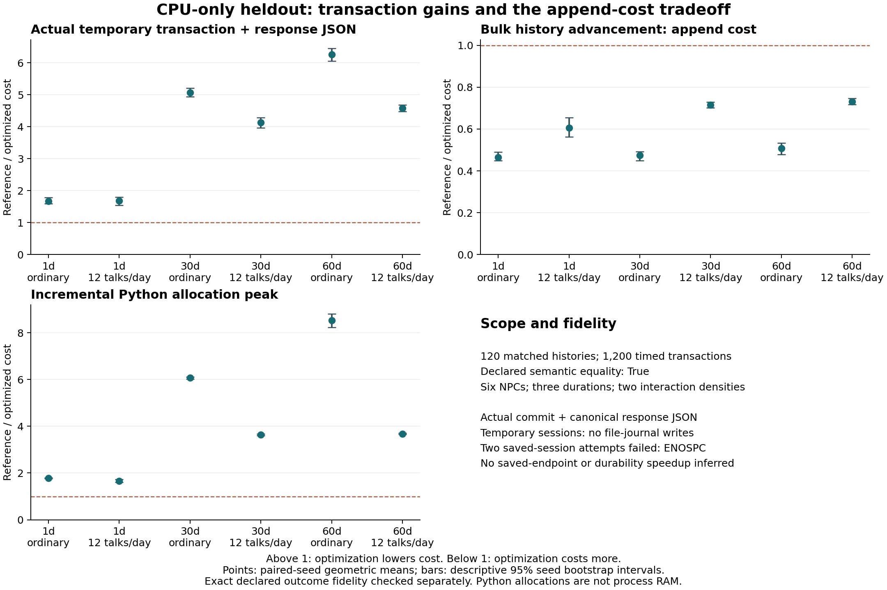

# Rebirth research results: faster isolated transactions, slower historical writes

21 October 2026. One completed, preregistered **temporary-session CPU-path study** found lower transaction latency without a declared semantic mismatch. It also found a consistent write-cost penalty. The saved-session performance protocol did not complete because actual journal writes failed with ENOSPC; it supports **no final durable-endpoint latency claim**.

## What changed and what was compared

`PersistentLedger` shares sealed historical event bodies across isolated candidate worlds and copies a streaming SHA-256 prefix. Current accounts, commitments, memories, plans and queues remain detached. Canonical event contents and legacy ledger hashes are preserved. This is immutable historical sharing and incremental hashing, not a new temporal-abstraction algorithm. The exact event scheduler is unchanged.

The reference is the **same Rebirth world and actual session path**, with `optimized=False`: the original mutable ledger, ordinary `deepcopy`, and full-history canonical hashing. It has the same scenario, actions, scheduler and validations. The optimized condition changes historical representation through one flag. There is no weakened minute-by-minute or invented slow baseline.

The primary measurement is actual `RebirthSession.commit('move', {'location':'street'})` plus the HTTP handler's canonical response JSON encoding, in a session with no journal path. It includes candidate isolation, authoritative movement, current state construction and response serialization. Session preparation, independent fidelity comparisons and a separate revision-hash read are outside this timer. It is wall-clock latency of a CPU path, not measured CPU cycles, browser frame rate, network response time or saved-file latency. The hash speedup is measured separately and is not added to the transaction gain.

## Registered design and completion

The [amended registration](../../results/rebirth/performance_cpu_preregistration.json) preceded fresh seeds 84000–84019. Twenty matched seeds span 1/30/60 world-day histories and ordinary versus twelve actual nearby Marcus conversations per day. All worlds contain six authored NPCs plus the Player; the stress condition grows interaction history, **not population**. Route assignment is seed modulo four, with five seeds per broker/market/household/ignored route. Broker commission and household-service prefixes deliberately include kept and missed outcomes.

Each mode/cell has one discarded transaction warmup and five fresh-session timed transactions against its prepared history. Pair order is deterministically shuffled independently of world randomness; garbage collection occurs before each timer. The six conditions are reported separately. Ratios are paired-seed geometric means with 2,000-resample descriptive 95% percentile bootstrap intervals. The independent unit is a seed, not each event or repeated transaction. These intervals describe this finite local workload; they do not quantify general game/player uncertainty.

Completed: **120/120 matched histories, 1,200 timed accepted transactions, 240 discarded warmups, 240 separate allocation traces, 240 in-memory command replays and 240 rejection-isolation checks.** Every declared history/transaction/response comparison passed. Replay serializes accepted commands through canonical JSON in RAM and executes the actual session operations; it is not a disk restart or crash-durability experiment.

Declared equality covers exact events/hash, accounts and goods, commitments/settlements, relationships/access, beliefs/provenance, ordinary and consolidated memories, plans, pending queue, game snapshot, account-parent and auxiliary supply/sale indexes, config and initial accounts. Only measured `snapshot.time_stats.wall_seconds` is excluded as nondeterministic diagnostic metadata. Raw rows retain projection digests and physical outcome summaries. Coverage includes 30 cells per route, 18 fulfilled/12 missed broker-commission cells, and 18 kept/8 missed household-service cells; four 1-day household cells have service not yet due. Counts are scenario coverage, not a behavioral success rate.

## Transaction results

Medians below are medians of the per-seed five-repeat medians, in milliseconds. The paired geometric gain is a distinct statistic; it need not equal the ratio of the two displayed medians.

| World days | History condition | Actual event range | Reference → optimized ms | Paired gain [95% descriptive interval] |
|---|---|---|---|---|
| 1 | Ordinary | 52–87 | 1.43 → 0.90 | 1.67× [1.59, 1.79] |
| 1 | 12 talks/day stress | 66–101 | 1.90 → 1.13 | 1.68× [1.55, 1.80] |
| 30 | Ordinary | 962–1047 | 13.99 → 2.76 | 5.07× [4.94, 5.21] |
| 30 | 12 talks/day stress | 1384–1467 | 20.23 → 4.84 | 4.13× [3.97, 4.28] |
| 60 | Ordinary | 1691–1866 | 24.25 → 3.85 | 6.26× [6.05, 6.46] |
| 60 | 12 talks/day stress | 2533–2706 | 37.79 → 8.36 | 4.57× [4.48, 4.68] |

The ordinary 60-day result is 24.25→3.85 ms with 6.26× paired gain. At one ordinary day the absolute median reduction is only about 0.52 ms. This does not establish that a player notices a responsiveness improvement, nor that rendering or an external model became faster.

## Costs, hashing and allocation limits

Every bulk-history ratio is **below 1**: optimized history advancement costs more. These are single paired advancement timings per cell, including new-event sealing/hash updates; they are an exploratory write-cost result, not a five-repeat endpoint estimate. Across conditions, paired reference/optimized ratios 0.465–0.731 correspond to roughly 1.37–2.15× higher optimized cost. At 60 ordinary days, median history advancement rose 41.16→81.55 ms; the stress condition rose 153.56→213.77 ms. The optimization therefore does not speed up total simulated social time.

Allocation values are separate `tracemalloc` incremental transaction peaks in decimal MB, not whole-world memory, RSS, GPU memory or file storage. Traced timings are discarded. Revision hashes are standalone median reads in milliseconds.

| Days | Condition | Bulk history ref/opt ratio [95% interval] | Transaction peak reference → optimized MB | Separate hash reference → optimized ms |
|---|---|---|---|---|
| 1 | Ordinary | 0.465 [0.450, 0.489] | 0.182 → 0.101 | 0.587 → 0.0019 |
| 1 | 12 talks/day stress | 0.607 [0.562, 0.654] | 0.261 → 0.149 | 0.708 → 0.0015 |
| 30 | Ordinary | 0.474 [0.449, 0.493] | 2.137 → 0.351 | 9.504 → 0.0027 |
| 30 | 12 talks/day stress | 0.716 [0.702, 0.729] | 2.710 → 0.742 | 13.095 → 0.0034 |
| 60 | Ordinary | 0.508 [0.479, 0.533] | 3.698 → 0.422 | 17.256 → 0.0036 |
| 60 | 12 talks/day stress | 0.731 [0.717, 0.746] | 4.725 → 1.289 | 23.959 → 0.0043 |

The representation trades append/sealing work for cheaper candidate copying and hash reads. There is no component ablation that identifies every contributor, and the primary temporary transaction does not include a journal persistence hash. No saved-game speedup should be inferred by summing separately timed operations.



## Interrupted protocols and environment

The failed/interrupted records remain separate and are never pooled with the completed CPU study:

| Artifact | Status | Completed cells |
|---|---|---|
| `performance_pilot_v1/` | Development source guard rejected a changed runtime; no valid final summary. | Diagnostic raw rows only |
| `performance_heldout_v1/` | Stopped for required action-schema/quantity-review correctness repairs; old seeds retired. | 53 |
| `performance_heldout_v2/` | Actual saved transaction failed ENOSPC; unchanged source. | 46 |
| `performance_heldout_v2_retry/` | One exact full-protocol retry failed ENOSPC again; all disk studies stopped. | 4 |

The two ENOSPC records are genuine persistence failures, not fidelity mismatches. A pre-first-attempt free-space reading was not captured; none is invented. The retry environment record and both failure records preserve available readings. The amended run started with 701,857,792 bytes free and ended with 757,800,960 bytes free. Small result-artifact writes occur outside transaction timing; application journal writes are absent from the amended protocol.

Environment: macOS 15.5 arm64, Python 3.12.14, one active development machine, no CPU isolation, and documented APFS low-space pressure. Other applications, paging, thermal changes and background work can influence wall times. Counterbalancing and discarded warmups reduce order effects but do not remove these limitations. Durable-save performance needs a stable-storage replication. Separate regression tests cover save/restart and I/O-failure rollback; their passing does not supply missing latency data or prove `fsync` crash durability.

## Provenance and reproduction

The registered **studied checkpoint is `3c971b6`**, with 66 Python-source fingerprint `daf68c3a424141c42ff21efb572c01b004e0fb24953dfe7a91299e42bd005d21`. The separately pinned amended runner is `4952810f5a662f83ba931d3f313c245bd4a9d8abbfc58687e1a79d4b3dafd0d6`. Later release repairs disclose public purchase prices, commission deadlines and resource availability, and select retained shared memories chronologically. Those changes have regression checks but were **not retimed**. These numbers describe the frozen studied checkpoint, not an exact measurement of the later release.

[Raw rows](../../results/rebirth/performance_cpu_heldout/raw.jsonl), [summary](../../results/rebirth/performance_cpu_heldout/summary.json), [machine/design metadata](../../results/rebirth/performance_cpu_heldout/metadata.json), and [independent artifact verification](../../results/rebirth/performance_cpu_heldout/verification.json) are preserved. Verification recomputed the complete condition summary from raw rows, checked all 120 registered cell keys and equality flags, and checked the then-frozen source/runner against registration. Raw data were not selected by effect size. The immutable baseline and earlier Pompeii studies remain untouched.

A same-seed replication needs the studied source, Python 3.10+ and a **new output directory**. From this repository, extract the checkpoint to a new temporary folder and copy the separately registered runner and registration into it:

```sh
REPLICATION_ROOT=$(mktemp -d /tmp/kalends-rebirth-replication.XXXXXX)
git archive 3c971b6 | tar -x -C "$REPLICATION_ROOT"
mkdir -p "$REPLICATION_ROOT/results/rebirth"
cp results/rebirth/performance_cpu_study.py results/rebirth/performance_cpu_preregistration.json "$REPLICATION_ROOT/results/rebirth/"
python3 "$REPLICATION_ROOT/results/rebirth/performance_cpu_study.py" run --output "$REPLICATION_ROOT/results/rebirth/my_cpu_replication"
MPLCONFIGDIR=/tmp/kalends-rebirth-mpl python3 results/rebirth/performance_plot.py results/rebirth/performance_cpu_heldout/summary.json results/rebirth/my_comparison.png
```

The replication folder and output remain available for inspection. The run refuses an existing output or changed registered source; running it against later release Python intentionally fails the source guard. A new method or genuinely fresh heldout evaluation needs a versioned registration/runner and unused seeds; do not overwrite this registration. Plotting alone needs Matplotlib and is outside the zero-dependency game runtime.

This result establishes a narrow application-level engineering tradeoff on six NPCs and finite authored routes. It does not establish general social realism, large-population scaling, unrestricted cognition, historical behavioral accuracy, human enjoyment/return, a defensible platform, or new causal time compression. See the [primary-source novelty audit](RESEARCH_NOVELTY_AUDIT.md). No such broader claim is needed to justify making the game and its local transaction path better.
