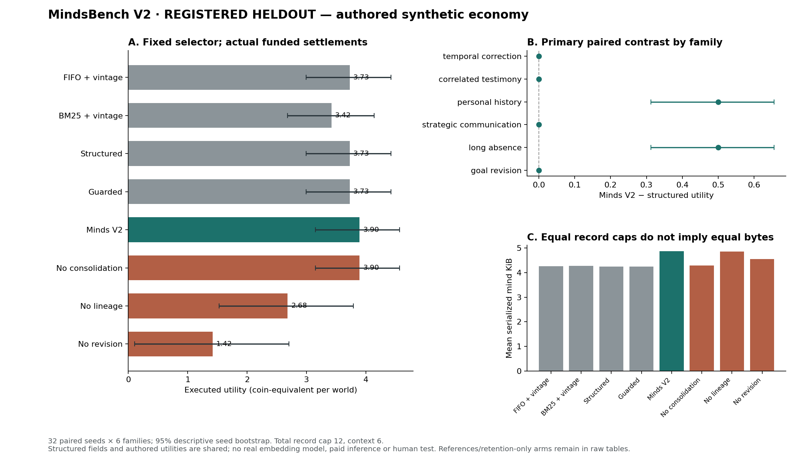

# MindsBench V2: registered heldout findings

The bounded V2 mind saves **0.167 coin-equivalent utility per world** against the bounded structured baseline in this authored economy. It does so by avoiding 32 one-coin verification payments across 192 paired worlds; both policies complete **176/192** goals. Disabling consolidation produces the same economic outcomes in every world with less serialized memory. These results support a narrow retention benefit, not a general intelligence, consolidation, planning, language, game enjoyment or novelty claim.

## Method and provenance

The [version3 registration](preregistration_v3.json) and [timestamped receipt](registration_receipt.json) were committed before the original heldout execution. The recovery execution verified the complete registration and source fingerprint `c0e78346bb44fb8fea116820c96af9d6f2acf405740d64cd830642fcfea46281` before starting and verified source stability afterward. The registered 32 seeds (97100–97131), six families and 14 arms yield 192 worlds and 2,688 executed arm cases. Eight development seeds and three inspected pilots remain separate.

The first run's uncommitted output disappeared with its temporary worktree. This directory contains an exact-method recovery execution using the same registered source, seeds and parameters, with no tuning. It is **not independent replication**. Its primary aggregate, completion counts and recorded null/negative findings agree with the inherited first-run summary. The unavailable first raw file cannot be compared directly; recorded local timings and timestamps also vary. [Recovery provenance and artifact digests](heldout_v3/recovery_provenance.json) explicitly distinguish the two. Current [raw data](heldout_v3/raw.jsonl) SHA256 is `eeb5d7ec74d56b14a606af832c75564ead109926df1a9d91b1959dd58a7cb796`.

All deployable arms receive the same scoped structured propositions and text tapes, public terms, own resources and fixed `AgentMind.choose` selector. The combined episodic/semantic/social/revision/reflection cap is 12 records; the complete decision read is capped at six records, across all keys and action options. Goal and last-decision state are separately bounded and included in serialized bytes. The original unbounded structured/guarded algorithms are adapted to this shared bounded context; they coincide on this keyed track. FIFO and BM25 also use the common dated-belief interpretation and planner. Equal record slots do not mean equal storage bytes.

The evaluator executes real funded cash transfers, goods deliveries, collateralized loans or authorized paid reports; verification costs one coin and one minute. Verification creates an endogenous legitimate observation, so later input streams can differ by policy. Actual world truth is used for execution/evaluation and the explicitly privileged reference, not deployable action selection. No verified modern embedding model was available; hashed lexical similarity is not presented as dense retrieval. No live model, paid inference or human participants were used.

## Registered primary contrast

V2 minus structured terminal utility, averaged over all six families within each seed: **+0.1667**, descriptive 95% paired seed bootstrap **[0.1042, 0.2188]**, 32 seed means and 2,000 fixed-seed resamples. There are **32 one-coin wins, 160 ties and no losses** in this contrast. Four authored control variants repeat across eight seeds each; the interval describes this sampled parameter mixture, not uncertainty over unobserved task types.

| Family (32 worlds each) | Mean V2 − structured | Descriptive 95% interval | Explanation |
|---|---:|---:|---|
| Temporal correction | 0.000 | [0.000, 0.000] | Both handle the admitted dated correction. |
| Correlated testimony | 0.000 | [0.000, 0.000] | Both pay for a check when communicated roots are insufficient. |
| Personal history | +0.500 | [+0.3125, +0.6563] | Sixteen retained-history cases avoid one paid check. |
| Strategic communication | 0.000 | [0.000, 0.000] | Both apply the admitted current permission. |
| Long absence | +0.500 | [+0.3125, +0.6563] | Sixteen retained-history cases avoid one paid check. |
| Goal revision | 0.000 | [0.000, 0.000] | Both use fixed resource/deadline checks. |

## All arms, including negative results

Completion and paid checks are counts out of 192. Memory is the mean final serialized mind size, including working state. Local selection timing is in the machine-readable summary but is an uncontrolled implementation diagnostic, not a performance ranking.

| Arm | Mean utility | Goals completed | Paid checks | Mean serialized bytes |
|---|---:|---:|---:|---:|
| FIFO + dated beliefs | 3.729 | 176 | 48 | 4,361 |
| BM25 + dated beliefs | 3.422 | 173 | 48 | 4,382 |
| Bounded structured | 3.729 | 176 | 48 | 4,359 |
| Bounded guarded | 3.729 | 176 | 48 | 4,359 |
| Minds V2 | 3.896 | 176 | 16 | 4,991 |
| No consolidation | 3.896 | 176 | 16 | 4,399 |
| No source lineage | 2.682 | 147 | 0 | 4,981 |
| No belief revision | 1.422 | 120 | 16 | 4,670 |
| Recency retention | 3.729 | 176 | 48 | 4,940 |
| Salience retention | 3.896 | 176 | 16 | 4,993 |
| Prediction-error retention | 3.729 | 176 | 48 | 4,950 |
| Goal relevance retention | 3.896 | 176 | 16 | 4,989 |
| Full observed-history reference (256-record cap) | 3.896 | 176 | 16 | 9,927 |
| Privileged world-truth reference (256-record cap) | 4.333 | 184 | 0 | 10,610 |

The reference arms have a much larger budget and are excluded from the primary comparison. The privileged reference is a ceiling for this fixed action set, not a deployable baseline or proof of globally optimal planning.



## What the traces establish, and what they do not

- **The gain comes from retention, not faster belief revision or better planning.** Structured and V2 both recover all 64 admitted corrections immediately in the recorded observation trace. Structured initially has an unknown belief in 32 cases, then buys a check; its final unknown rate of zero hides that cost. V2 and structured have identical final goal completion.
- **Consolidation has no demonstrated outcome benefit.** Removing it leaves utility, completion, actual transfers/goods, reports, verification and terminal time identical in all 192 worlds. The ablation uses about 592 fewer serialized bytes on average. Salience-only and goal-relevance retention also tie V2 utility. Reflection is never invoked by this study, so no reflection benefit is tested.
- **Caution can cost money.** On eight true-rumor correlated-testimony controls, removing lineage beats V2 by one coin because the unsupported gamble happens to be right. The same ablation fares worse overall. Eight false-world cases remain unobserved and defeat V2: honest memory cannot infer a hidden change. The other eight V2 noncompletions are deliberately impossible deadlines where abstention is feasible behavior, not eight demonstrated planning bugs.
- **The ablations are engineering configurations.** Removing lineage can also change compact-head retention; its result is not a clean causal estimate of source counting alone. The source-group diagnostic compares currently retrieved support with all admitted claims, so bounded omission contributes to its error; it is not an independently labeled attribution accuracy score. Failure-stage tags are deterministic diagnostics with overlapping semantic issues, not adjudicated causal diagnoses.
- **Fresh parameters are not unseen tasks.** Heldout wording, 48–80 routine-event interference, five–eight relays and late stale reports differ from development, but all six families, schemas, action utilities and four control variants are authored. Structured fields are shared assistance. This does not test natural-language extraction, learned long-range plans, live-provider quality, full-game player outcomes or human enjoyment.

For a concrete inspection, seed97100/personal_history makes structured choose `verify → preferred_proof` for utility5 while V2 chooses `preferred_testimony` for utility6; both fulfill the arrangement. In seed97100/correlated_testimony the true rumor lets no-lineage earn6 versus V2's cautious5. In seed97101/correlated_testimony the rumor is false: no-lineage loses5 while V2 checks and safely earns2. These are descriptive trace examples, not additional statistical tests.

The [primary-source comparison](../../docs/minds_v2/LITERATURE_AND_DESIGN.md) documents close prior art in memory-conditioned action, consolidation, source correlation, explicit belief state and validated recovery. The defensible contribution here is an inspectable implementation and a controlled, bounded-information economic test. No reviewed-paper superiority or novel general memory architecture is established.

## Verification and reproduction

The [independent verifier](verify_artifacts.py) imports neither the memory module nor the generator/evaluator. It re-folds each saved cash/goods ledger, terminal utility and completion; checks the complete seed/family/arm grid, conservation, cited observation IDs and recorded storage/context caps; and recomputes the primary and family bootstrap intervals. [Verification output](heldout_v3/verification.json) passes all 2,688 arm cases. This verifies recorded arithmetic and constraints, not external validity or the absence of every implementation bug. The 42 focused mind/benchmark tests pass.

From the repository root, choose a new output directory because existing runs are preserved:

```sh
python3.12 -m kalends_rebirth.mindsbench_v2 run --registration results/minds_v2/preregistration_v3.json --out /tmp/kalends-heldout-reproduction
python3.12 results/minds_v2/verify_artifacts.py /tmp/kalends-heldout-reproduction
MPLCONFIGDIR=/tmp/kalends-mpl python3 results/minds_v2/plot_results.py /tmp/kalends-heldout-reproduction /tmp/kalends-heldout-comparison.png
```

Python3.10+ is required for the runtime; plotting uses Matplotlib and can run separately under Python3.9. Reproduction requires the registered source fingerprint: if game work later changes the mind module, use this evidence commit or restore the registered versions before rerunning. [Full summary](heldout_v3/summary.json), [descriptive diagnostics](heldout_v3/diagnostics.json) and [raw cases](heldout_v3/raw.jsonl) preserve every arm and failure.
